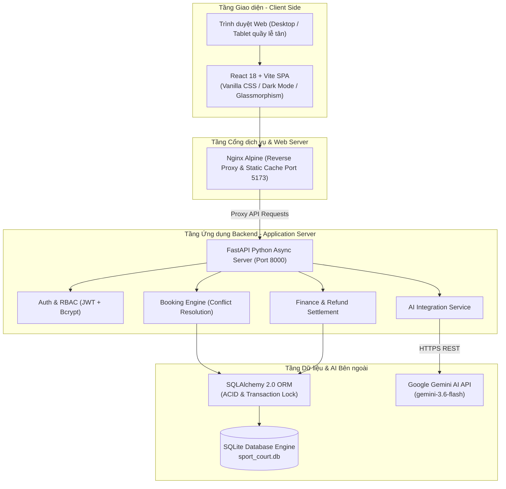

# Hệ thống Quản lý Sân Thể Thao Cho Thuê Tích Hợp AI (SportBooking Pro) - Phiên Bản Quản Trị & Vận Hành Thông Minh

> **Môn học:** [Tên môn học - Mã học phần: AIA331 / Mã đề tài: 80302]  
> **Sinh viên / Nhóm thực hiện:** Dương Tiến Dũng (Nhóm 14)  
> **Mã số sinh viên (MSSV):** DTC245180183  
> **Lớp:** KTPM K23B  
> **Email:** DTC245180183@ictu.edu.vn  
> **Repository GitHub:** [https://github.com/dtc245180183-blip/DTC245180183-sportbooking-ai](https://github.com/dtc245180183-blip/DTC245180183-sportbooking-ai)

---

## 1. Giới thiệu Đề tài

### 1.1. Bối cảnh & Bài toán Thực tế
Trong kinh doanh sân thể thao hiện đại, các cụm phức hợp thường khai thác nhiều loại hình sân khác nhau: **Sân Bóng đá mini cỏ nhân tạo**, **Sân Cầu lông trong nhà tiêu chuẩn**, và các cụm **Sân Pickleball** đang phát triển mạnh mẽ. Tuy nhiên, phần lớn các cơ sở hiện nay vẫn vận hành theo phương thức truyền thống:
- **Xung đột & Trùng lịch (Double-Booking):** Tiếp nhận đặt sân phân tán qua điện thoại, Zalo, sổ tay hoặc bảng tính Excel rời rạc dẫn đến việc ghi nhận trùng giờ, gây ảnh hưởng tiêu cực đến trải nghiệm của khách hàng và uy tín của cơ sở.
- **Thiếu minh bạch tài chính & Khó đối soát tiền cọc:** Quy trình thu cọc, giữ chỗ, quyết toán hóa đơn cuối buổi và áp dụng chính sách hoàn tiền cọc khi hủy lịch cận giờ diễn ra thủ công, dễ thất thoát và khó kiểm tra chéo giữa ca trực.
- **Lãng phí công suất ngoài giờ cao điểm:** Các khung giờ thấp điểm (sáng sớm, đầu giờ chiều các ngày trong tuần) thường vắng khách nhưng chủ cơ sở thiếu công cụ phân tích dữ liệu để đưa ra các gói khuyến mại hoặc chính sách định giá linh hoạt kịp thời.

### 1.2. Giải pháp của Hệ thống SportBooking Pro
**SportBooking Pro** là giải pháp phần mềm quản trị và vận hành toàn diện, chuyên nghiệp hóa toàn bộ vòng đời đặt sân tại quầy kết hợp ứng dụng Trí tuệ Nhân tạo:
1. **Kiểm soát lịch đặt sân theo thời gian thực:** Áp dụng cơ chế khóa dòng giao dịch CSDL (*Database Transaction Locking with `with_for_update`*), ngăn chặn triệt để tình trạng hai nhân viên hoặc hai tác vụ cùng đặt một khung giờ sân tại cùng một thời điểm.
2. **Minh bạch hóa dòng tiền & Đối soát tài chính chặt chẽ:** Tích hợp quản lý thanh toán đa trạng thái (`cọc - deposit`, `thực thu toàn phần - paid`, `hoàn tiền cọc - refund`), hạch toán dòng tiền rõ ràng theo từng ca làm việc của nhân viên và tổng hợp doanh thu chính xác.
3. **Ứng dụng Trí tuệ Nhân tạo (Google Gemini AI) hai chiều:**
   - **Trợ lý nhân viên (Front-desk Assistant):** Tự động phát hiện các khung giờ trống tương đương khi xảy ra xung đột lịch để gợi ý cho khách (`AI Smart Slot Suggestion`); tự động soạn thảo tin nhắn xác nhận lịch và nhắc nhở khách trước giờ thi đấu theo văn phong lịch sự, chuyên nghiệp (`AI Customer Notification Generator`).
   - **Cố vấn quản trị (Management Advisor):** Tổng hợp dữ liệu vận hành thực tế, phân tích tỷ lệ lấp đầy sân (occupancy rate) và đề xuất các chiến lược kinh doanh, khung giờ vàng, chính sách giảm giá kích cầu khoa học (`AI Business Insights`).

---

## 2. Phân quyền Tác nhân & Chức năng (12 Use Cases)

Hệ thống được thiết kế theo mô hình Phân quyền Dựa trên Vai trò (**Role-Based Access Control - RBAC**), phân tách rõ ràng trách nhiệm giữa người quản lý cơ sở và nhân viên trực quầy.

### 2.1. Phân định Trách nhiệm Tác nhân

| Tác nhân (Actor) | Bản chất vai trò | Phạm vi trách nhiệm chính |
| :--- | :--- | :--- |
| **Quản lý (Admin)** | Chủ cơ sở / Giám đốc điều hành | Quản lý danh mục sân, cấu hình bảng giá, tạo khung giờ, quản lý lịch bảo dưỡng, kiểm soát nhân sự, theo dõi doanh thu và nhận tư vấn chiến lược từ AI. |
| **Nhân viên trực quầy (Staff)** | Lễ tân / Nhân viên ca trực | Trực quan hóa lưới lịch, tạo/đổi/hủy đơn đặt sân, quản lý hồ sơ khách hàng, thu cọc/quyết toán/hoàn cọc, sử dụng AI gợi ý giờ trống và sinh tin nhắn CSKH. |
| **Khách hàng (Customer)** | Khách chơi thể thao *(Tác nhân phụ)* | Liên hệ đặt lịch qua điện thoại hoặc trực tiếp tại quầy, nhận tin nhắn thông báo xác nhận và thanh toán hóa đơn thông qua nhân viên. |

### 2.2. Ma trận Phân quyền 12 Use Cases (RBAC Matrix)

```mermaid
flowchart TD
    subgraph Quản trị viên [Quản lý - Admin]
        direction TB
        UC1[UC-01: Quản lý Sân & Bảng giá]
        UC2[UC-02: Thiết lập Khung giờ]
        UC3[UC-03: Lập lịch Bảo trì & Khóa sân]
        UC4[UC-04: Thống kê Doanh thu & Công suất]
        UC5[UC-05: Quản lý Tài khoản Nhân viên]
        UC6[UC-06: AI Phân tích & Gợi ý Khuyến mại]
    end

    subgraph Lễ tân [Nhân viên trực quầy - Staff]
        direction TB
        UC7[UC-07: Xem Lịch đặt sân Trực quan]
        UC8[UC-08: Đặt, Đổi, Hủy Lịch đặt sân]
        UC9[UC-09: Quản lý Hồ sơ Khách hàng]
        UC10[UC-10: Thu cọc, Quyết toán & Hoàn cọc]
        UC11[UC-11: AI Gợi ý Khung giờ trống]
        UC12[UC-12: AI Sinh Tin nhắn CSKH]
    end

    subgraph AIEngine [Google Gemini AI Service]
        AISlot[Gợi ý slot trống thay thế]
        AINotif[Soạn tin nhắn SMS/Zalo]
        AIReport[Phân tích biểu đồ & đề xuất giá]
    end

    UC6 -.-> AIReport
    UC11 -.-> AISlot
    UC12 -.-> AINotif
```



| Mã UC | Tên Ca Sử Dụng (Use Case) | Tác nhân chính | Quyền Admin | Quyền Staff | Mô tả tóm tắt nghiệp vụ |
| :---: | :--- | :---: | :---: | :---: | :--- |
| **UC-01** | Quản lý Sân & Bảng giá | Admin | **Toàn quyền** | Chỉ xem | Thêm mới, chỉnh sửa thông tin sân, cấu hình đơn giá theo từng loại hình sân (Bóng đá, Cầu lông, Pickleball). |
| **UC-02** | Thiết lập Khung giờ hoạt động | Admin | **Toàn quyền** | Chỉ xem | Khởi tạo ma trận các khung giờ trong ngày (Slot sáng/chiều/tối) làm căn cứ mở bán và xếp lịch. |
| **UC-03** | Lập lịch Bảo trì & Khóa sân | Admin | **Toàn quyền** | Không | Đặt lịch bảo dưỡng mặt cỏ, sửa chữa hệ thống đèn; hệ thống tự động khóa các slot tương ứng để chặn đặt lịch. |
| **UC-04** | Thống kê Doanh thu & Công suất | Admin | **Toàn quyền** | Không | Biểu đồ trực quan doanh thu theo ngày/tháng, tỷ lệ lấp đầy theo từng sân, đối soát tổng tiền thực thu và hoàn cọc. |
| **UC-05** | Quản lý Tài khoản Nhân viên | Admin | **Toàn quyền** | Không | Cấp mới tài khoản ca trực, đổi mật khẩu, phân quyền vai trò và khóa tài khoản khi nhân viên nghỉ việc. |
| **UC-06** | AI Phân tích & Gợi ý Khuyến mại | Admin | **Toàn quyền** | Không | Google Gemini phân tích dữ liệu kinh doanh, nhận diện khung giờ ế ẩm và sinh đề xuất kích cầu thông minh. |
| **UC-07** | Xem Lịch đặt sân Trực quan | Staff, Admin | Xem & Lọc | Xem & Lọc | Lưới lịch tương tác (Interactive Grid) theo ngày, hiển thị trạng thái sân bằng màu sắc trực quan (Trống, Đã đặt, Bảo trì). |
| **UC-08** | Đặt / Đổi / Hủy Lịch đặt sân | Staff, Admin | Thực hiện | Thực hiện | Tạo mới đơn đặt sân tại quầy; hỗ trợ đổi giờ/sân hoặc hủy lịch kèm kiểm tra xung đột thời gian thực. |
| **UC-09** | Quản lý Hồ sơ Khách hàng | Staff, Admin | Quản lý | Quản lý | Lưu trữ danh bạ khách hàng, tra cứu nhanh lịch sử đặt sân theo số điện thoại, ghi nhận tần suất thuê. |
| **UC-10** | Thu cọc, Quyết toán & Hoàn cọc | Staff, Admin | Thực hiện | Thực hiện | Ghi nhận tiền đặt cọc giữ sân, thu phần tiền còn lại khi trả sân, hoặc hoàn cọc theo tỷ lệ quy định khi khách báo hủy sớm. |
| **UC-11** | AI Gợi ý Khung giờ trống | Staff, Admin | Sử dụng | Sử dụng | Khi khách yêu cầu giờ đã bị kín, AI lập tức quét CSDL và đề xuất 2-3 lựa chọn thay thế khả thi nhất. |
| **UC-12** | AI Sinh Tin nhắn CSKH | Staff, Admin | Sử dụng | Sử dụng | Tự động sinh nội dung tin nhắn xác nhận đặt cọc hoặc nhắc nhở giờ thi đấu gửi qua Zalo/SMS cho khách hàng. |

---

## 3. Kiến trúc Hệ thống & Công nghệ Sử dụng

### 3.1. Sơ đồ Kiến trúc Tổng thể (System Architecture)



### 3.2. Chi tiết Ngăn xếp Công nghệ (Tech Stack)

- **Backend Framework:** **FastAPI** (Python 3.10+ / 3.11)
  - Kiến trúc bất đồng bộ (Asynchronous ASGI) cho tốc độ phản hồi cực nhanh (< 50ms cho các API nghiệp vụ).
  - Sử dụng **Pydantic v2** để kiểm thực chặt chẽ cấu trúc dữ liệu đầu vào/đầu ra (Data Validation).
  - Tự động sinh tài liệu chuẩn hóa tương tác theo chuẩn **OpenAPI / Swagger UI**.
- **Cơ sở dữ liệu & ORM:** **SQLAlchemy 2.0** kết hợp **SQLite Engine** (`sport_court.db`)
  - Thiết kế chuẩn hóa theo mô hình quan hệ (RDBMS), đảm bảo tính toàn vẹn khóa ngoại (Foreign Keys) và tuân thủ nguyên lý ACID.
  - Sử dụng khóa dòng giao dịch (`with_for_update`) giải quyết triệt để bài toán đồng thời (Concurrency Control).
- **Frontend Framework:** **React 18** & **Vite 5**
  - **Vite:** Công cụ đóng gói hiện đại, hỗ trợ Hot Module Replacement (HMR) tức thì.
  - **Styling:** **Vanilla CSS** theo hệ thống Design System riêng biệt, tối ưu hiệu năng render, áp dụng phong cách thiết kế cao cấp **Dark Mode kết hợp hiệu ứng kính mờ (Glassmorphism)**.
  - **Data Visualization & Icons:** Thư viện **Recharts** dựng biểu đồ doanh thu tương tác và bộ icon chuẩn mực **Lucide-react**.
- **Tích hợp Trí tuệ Nhân tạo (AI Engine):** **Google Gemini AI API**
  - Khai thác mô hình ngôn ngữ lớn tốc độ cao `gemini-3.6-flash` / `gemini-1.5-flash`.
  - Thiết kế Prompt chuyên biệt cho ngữ cảnh quản lý thể thao, tích hợp bảng nhật ký `ai_logs` theo dõi thời gian phản hồi (latency), lượng token tiêu thụ và cơ chế phục hồi lỗi (Fault Tolerance Fallback).
- **Đóng gói & Ảo hóa:** **Docker & Docker Compose**
  - `backend/Dockerfile`: Môi trường Python Slim tối ưu dung lượng và thời gian khởi động.
  - `frontend/Dockerfile`: Mô hình Multi-stage build với máy chủ **Nginx Alpine** siêu nhẹ đóng vai trò Reverse Proxy chuyển tiếp các API `/auth`, `/bookings`, `/courts`...

---

## 4. Cấu trúc Thư mục Dự án

```
DTC245180183-sportbooking-ai/
├── .env.example                # File mẫu cấu hình biến môi trường toàn cục
├── .gitignore                  # Cấu hình loại trừ mã nguồn rác, cache và môi trường ảo
├── docker-compose.yml          # Kịch bản triển khai đa dịch vụ Docker (Backend, Frontend)
├── project_documents.md        # Tài liệu phân tích thiết kế hệ thống & lược đồ CSDL
├── README.md                   # Tài liệu báo cáo chính thức của đồ án (file hiện tại)
├── WORKFLOW.md                 # Nhật ký quy trình kiểm thử và luồng nghiệp vụ
│
├── backend/                    # Mã nguồn Máy chủ Dịch vụ (FastAPI)
│   ├── .dockerignore           # Loại trừ thư mục không cần thiết khi build Docker
│   ├── .env.example            # Biến môi trường mẫu cho Backend
│   ├── .gitignore              # Gitignore cục bộ cho môi trường Python
│   ├── Dockerfile              # Dockerfile đóng gói ứng dụng FastAPI
│   ├── requirements.txt        # Danh mục thư viện Python (FastAPI, SQLAlchemy, Gemini...)
│   ├── sport_court.db          # CSDL SQLite mẫu chuẩn hóa (đã nạp sẵn 12 đơn & dữ liệu gốc)
│   └── app/
│       ├── main.py             # Điểm khởi động ứng dụng FastAPI & đăng ký Routers
│       ├── database.py         # Khởi tạo kết nối SQLAlchemy Engine & SessionLocal
│       ├── dependencies.py     # Middleware xác thực JWT & phân quyền RBAC
│       ├── ai/                 # Tầng tích hợp Trí tuệ Nhân tạo
│       │   ├── gemini_client.py# Client giao tiếp Google Gemini API & cơ chế Retry
│       │   └── prompts.py      # Bộ thư viện System & User Prompts chuẩn hóa
│       ├── core/               # Cấu hình hệ thống & nạp biến môi trường Settings
│       ├── models/             # Định nghĩa các thực thể CSDL (User, Court, Booking, Payment...)
│       ├── routers/            # Các điểm cuối API (Auth, Courts, Bookings, AI, Statistics...)
│       ├── schemas/            # Lược đồ Pydantic kiểm thực dữ liệu (Request/Response DTO)
│       └── services/           # Nghiệp vụ lõi (Booking Service, AI Log Service)
│
├── frontend/                   # Mã nguồn Giao diện Người dùng (React + Vite)
│   ├── .dockerignore           # Loại trừ thư mục build/node_modules khi build Docker
│   ├── Dockerfile              # Dockerfile Multi-stage (Node Build -> Nginx Serve)
│   ├── nginx.conf              # Cấu hình Reverse Proxy Nginx điều hướng API & SPA routing
│   ├── package.json            # Danh mục phụ thuộc Frontend (React, Lucide, Recharts...)
│   ├── vite.config.js          # Cấu hình Vite Dev Server & Proxy cục bộ
│   ├── index.html              # Trang gốc ứng dụng Single Page Application
│   └── src/
│       ├── App.jsx             # Điều hướng trung tâm (React Router) & Layout bọc
│       ├── main.jsx            # Điểm gắn kết React DOM
│       ├── api/                # Các module gọi API qua Axios
│       ├── components/         # Các thành phần giao diện tái sử dụng (Header, Sidebar, Modal...)
│       ├── context/            # Ngữ cảnh quản lý phiên đăng nhập (AuthContext)
│       └── pages/              # Các màn hình nghiệp vụ (Dashboard, Calendar, Analytics...)
│
└── docs/                       # Tài liệu nghiên cứu chuyên sâu & minh chứng đồ án
    ├── ai_log.md               # Nhật ký kỹ thuật tích hợp AI & kịch bản prompt
    ├── database_design.md      # Lược đồ quan hệ thực thể (ERD) & chi tiết bảng
    ├── requirements.md         # Đặc tả yêu cầu phần mềm chi tiết (SRS)
    └── use_cases.md            # Tài liệu đặc tả 12 Ca sử dụng kèm kịch bản luồng sự kiện
```

---

## 5. Hướng dẫn Triển khai & Khởi chạy

### 5.1. Triển khai Nhanh bằng Docker & Docker Compose (Khuyến nghị để Chấm điểm)

Toàn bộ hệ thống Backend, Frontend và Cơ sở dữ liệu mẫu đã được cấu hình trọn gói trong Docker Compose. Giảng viên và người đánh giá có thể chạy dự án ngay lập tức bằng các bước sau:

#### Bước 1: Sao chép tệp cấu hình môi trường
Từ thư mục gốc của dự án, tạo file `.env` cho backend từ file mẫu:
- **Trên Windows (PowerShell / Command Prompt):**
  ```powershell
  copy backend\.env.example backend\.env
  ```
- **Trên Linux / macOS:**
  ```bash
  cp backend/.env.example backend/.env
  ```

> [!NOTE]
> File `.env.example` đã được điền sẵn khóa API thử nghiệm cho Google Gemini AI (`GEMINI_API_KEY`). Nếu muốn sử dụng khóa cá nhân của bạn, hãy mở file `backend/.env` và cập nhật giá trị `GEMINI_API_KEY`.

#### Bước 2: Xây dựng và khởi chạy các Container
Chạy lệnh duy nhất sau tại thư mục gốc:
```bash
docker compose up -d --build
```

#### Bước 3: Truy cập hệ thống
Sau khi các container khởi động hoàn tất (khoảng 30 - 60 giây cho lần đầu tải image):
- 🌐 **Giao diện Ứng dụng Web (Frontend):** [http://localhost:5173](http://localhost:5173)
- 📚 **Tài liệu Tương tác API Swagger (Backend):** [http://localhost:8000/docs](http://localhost:8000/docs)
- 📖 **Tài liệu API Chuẩn ReDoc:** [http://localhost:8000/redoc](http://localhost:8000/redoc)

---

### 5.2. Khởi chạy Cục bộ (Local Development)

Nếu muốn khởi chạy và gỡ lỗi (debug) từng thành phần trong môi trường phát triển:

#### 1. Khởi chạy Backend (FastAPI)
1. Mở cửa sổ Terminal thứ nhất và di chuyển vào thư mục `backend`:
   ```bash
   cd backend
   ```
2. Tạo và kích hoạt môi trường ảo Python:
   - **Windows:**
     ```powershell
     python -m venv venv
     .\venv\Scripts\activate
     ```
   - **Linux / macOS:**
     ```bash
     python3 -m venv venv
     source venv/bin/activate
     ```
3. Cài đặt các thư viện phụ thuộc:
   ```bash
   pip install -r requirements.txt
   ```
4. Đảm bảo file `.env` đã được tạo từ `.env.example`:
   ```powershell
   copy .env.example .env
   ```
5. Khởi chạy máy chủ phát triển Uvicorn:
   ```bash
   uvicorn app.main:app --reload --port 8000
   ```
   *Máy chủ API sẽ hoạt động tại: `http://localhost:8000`*

#### 2. Khởi chạy Frontend (React + Vite)
1. Mở cửa sổ Terminal thứ hai và di chuyển vào thư mục `frontend`:
   ```bash
   cd frontend
   ```
2. Cài đặt các gói thư viện Node.js:
   ```bash
   npm install
   ```
3. Khởi chạy Vite Dev Server:
   ```bash
   npm run dev
   ```
   *Giao diện người dùng sẽ sẵn sàng tại: `http://localhost:5173`*

---

### 5.3. Tài khoản Đăng nhập Mẫu & Dữ liệu Kiểm thử Sẵn có

Trong cơ sở dữ liệu mẫu `backend/sport_court.db` đi kèm, hệ thống đã nạp sẵn các tài khoản với phân quyền tương ứng để phục vụ việc nghiệm thu ngay lập tức:

| Vai trò (Role) | Tên đăng nhập (Username) | Mật khẩu (Password) | Chức năng trải nghiệm chính |
| :--- | :---: | :---: | :--- |
| **Quản trị viên (Admin)** | `admin` | `admin123` | Toàn quyền cấu hình sân, bảng giá, xem thống kê biểu đồ doanh thu, quản lý tài khoản nhân viên và sử dụng AI phân tích kinh doanh. |
| **Nhân viên trực quầy (Staff)** | `staff` | `staff123` | Quản lý lưới lịch đặt sân, thực hiện tạo đơn, thu cọc, đổi sân, hoàn tiền và gọi trợ lý AI gợi ý khung giờ / tạo tin nhắn khách hàng. |

#### 📊 Thông tin Dữ liệu Mẫu trong CSDL:
- **Danh mục Sân thể thao:** 3 sân chính đại diện cho các bộ môn phổ biến (Sân Bóng đá mini cỏ nhân tạo, Sân Cầu lông tiêu chuẩn, Sân Pickleball chuyên nghiệp).
- **12 Đơn đặt sân chuẩn mẫu:** Trải đều trên các trạng thái nghiệp vụ thực tế (`completed` - đã thanh toán toàn phần, `cancelled` - đã hủy và hoàn cọc minh bạch, `booked` - đã cọc và đang giữ chỗ).
- **Hạch toán Dòng tiền Chuẩn:** Tổng thực thu trong cơ sở dữ liệu mẫu đạt **1,750,000 VNĐ** (đã trừ khoản tiền hoàn cọc hợp lệ), phản ánh chính xác báo cáo doanh thu trên màn hình Dashboard và biểu đồ thống kê tài chính.

---

**© 2025 SportBooking Pro · Nhóm 14 - KTPM K23B - Trường Đại học Công nghệ Thông tin & Truyền thông (ICTU)**
