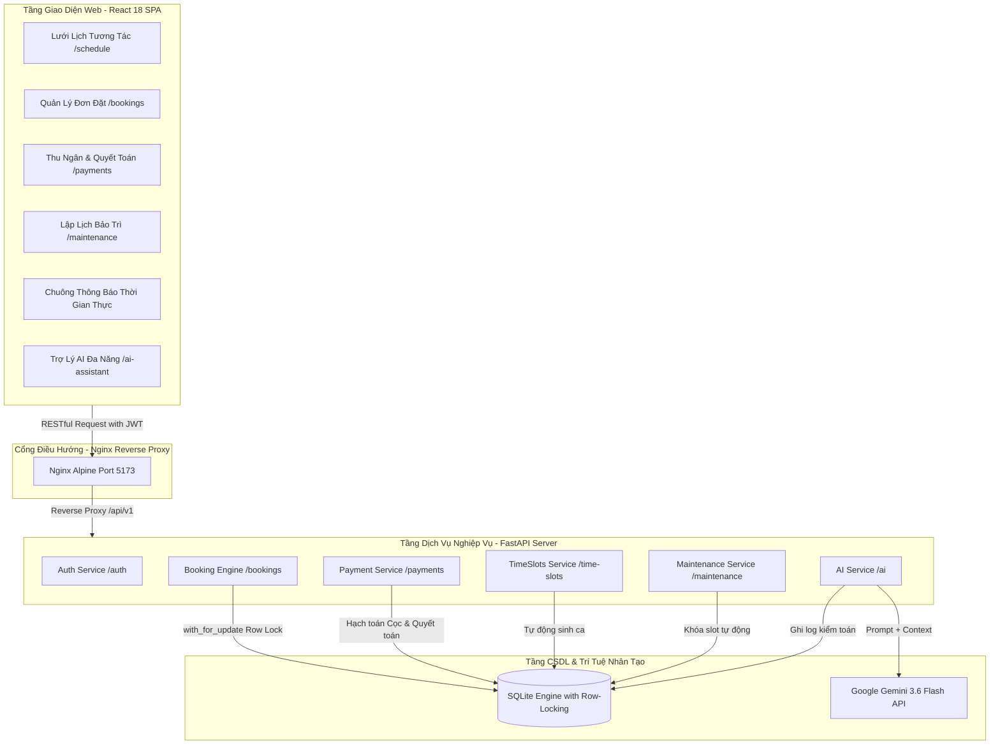
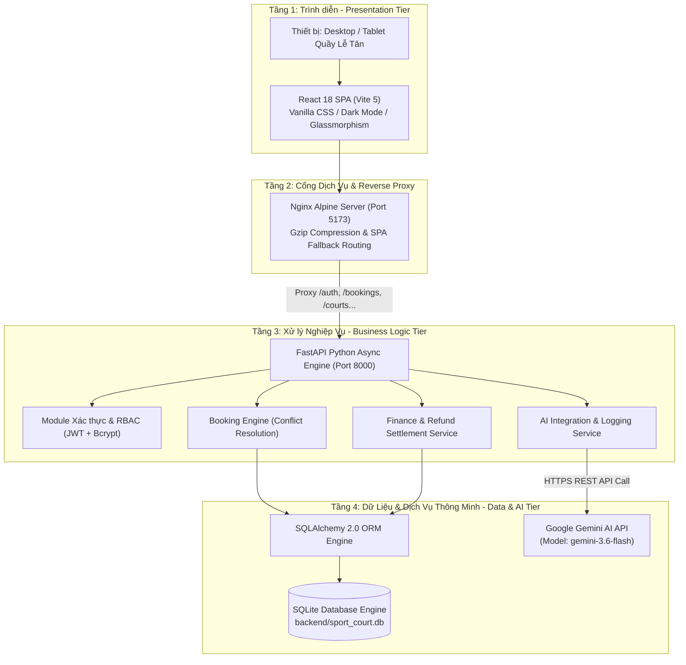
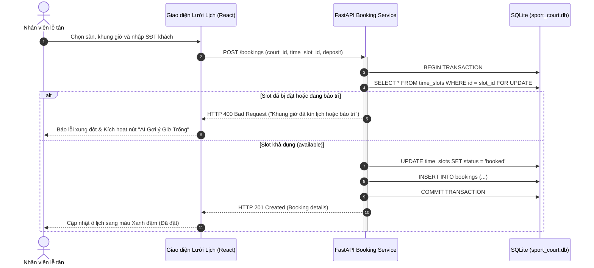
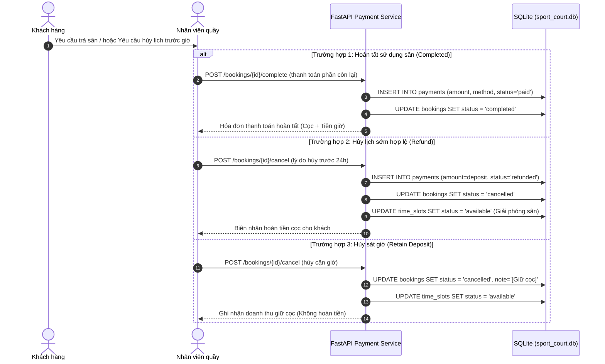
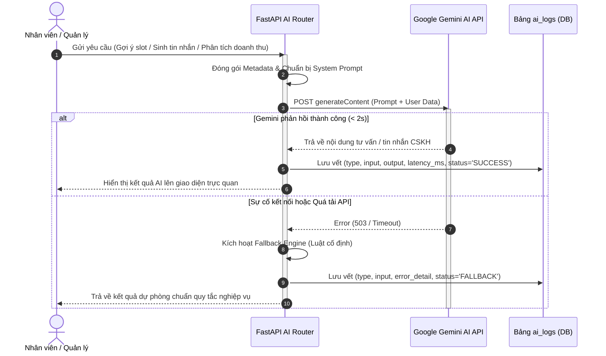
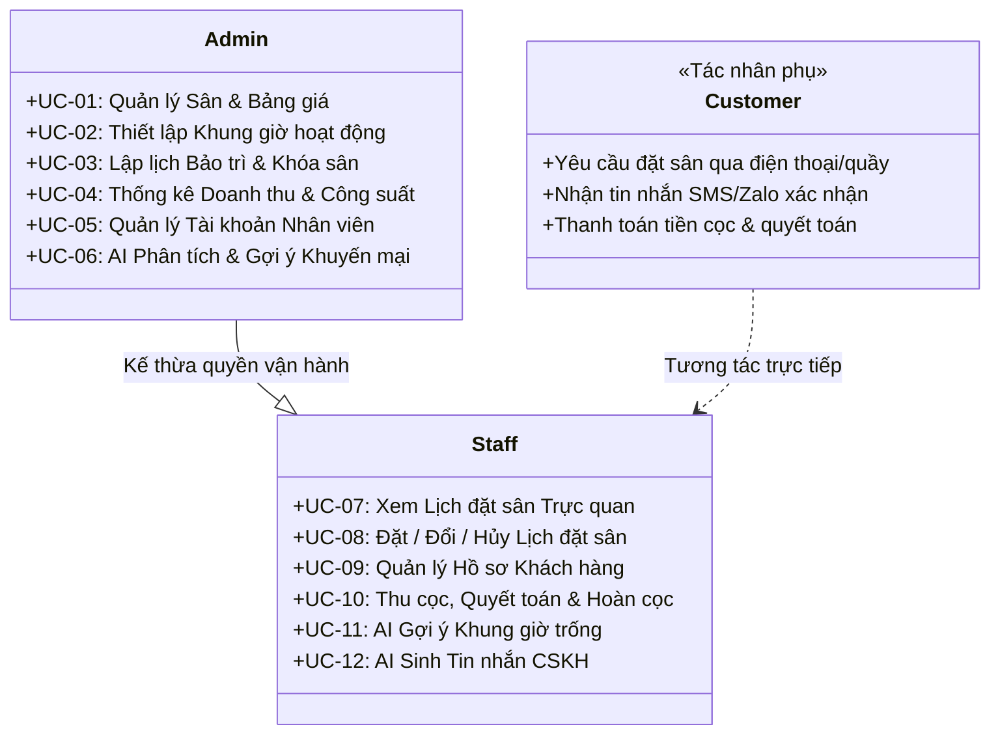

# Hệ thống Quản lý Sân Thể Thao Cho Thuê Tích Hợp AI (SportBooking Pro) - Phiên Bản Quản Trị & Vận Hành Thông Minh

> **Môn học:** [Tên môn học - Mã học phần: AIA331 / Mã đề tài: 80302]  
> **Sinh viên / Nhóm thực hiện:** Dương Tiến Dũng (Nhóm 14)  
> **Mã số sinh viên (MSSV):** DTC245180183  
> **Lớp:** KTPM K23B  
> **Email:** DTC245180183@ictu.edu.vn  
> **Repository GitHub:** [https://github.com/dtc245180183-blip/DTC245180183-sportbooking-ai](https://github.com/dtc245180183-blip/DTC245180183-sportbooking-ai)

---

## 1. Giới thiệu Đề tài

### 1.1. Bối cảnh & Bài toán Thực tế
Trong kinh doanh sân thể thao hiện đại, các cụm phức hợp thường khai thác nhiều loại hình sân khác nhau: **Sân Bóng đá mini cỏ nhân tạo**, **Sân Cầu lông trong nhà tiêu chuẩn**, và các cụm **Sân Pickleball** đang phát triển mạnh mẽ. Tuy nhiên, phần lớn các cơ sở hiện nay vẫn vận hành theo phương thức truyền thống:
- **Xung đột & Trùng lịch (Double-Booking):** Tiếp nhận đặt sân phân tán qua điện thoại, Zalo, sổ tay hoặc bảng tính Excel rời rạc dẫn đến việc ghi nhận trùng giờ, gây ảnh hưởng tiêu cực đến trải nghiệm của khách hàng và uy tín của cơ sở.
- **Thiếu minh bạch tài chính & Khó đối soát tiền cọc:** Quy trình thu cọc, giữ chỗ, quyết toán hóa đơn cuối buổi và áp dụng chính sách hoàn tiền cọc khi khách hủy lịch cận giờ diễn ra thủ công, dễ thất thoát và khó kiểm tra chéo giữa ca trực.
- **Lãng phí công suất ngoài giờ cao điểm:** Các khung giờ thấp điểm (sáng sớm, đầu giờ chiều các ngày trong tuần) thường vắng khách nhưng chủ cơ sở thiếu công cụ phân tích dữ liệu để đưa ra các gói khuyến mại hoặc chính sách định giá linh hoạt kịp thời.

### 1.2. Giải pháp của Hệ thống SportBooking Pro
**SportBooking Pro** là giải pháp phần mềm quản trị và vận hành toàn diện, chuyên nghiệp hóa toàn bộ vòng đời đặt sân tại quầy kết hợp ứng dụng Trí tuệ Nhân tạo:
1. **Kiểm soát lịch đặt sân theo thời gian thực:** Áp dụng cơ chế khóa dòng giao dịch CSDL (*Database Transaction Locking with `with_for_update`*), ngăn chặn triệt để tình trạng hai nhân viên hoặc hai tác vụ cùng đặt một khung giờ sân tại cùng một thời điểm.
2. **Minh bạch hóa dòng tiền & Đối soát tài chính chặt chẽ:** Tích hợp quản lý thanh toán đa trạng thái (`cọc - deposit`, `thực thu toàn phần - paid`, `hoàn tiền cọc - refund`), hạch toán dòng tiền rõ ràng theo từng ca làm việc của nhân viên và tổng hợp doanh thu chính xác.
3. **Ứng dụng Trí tuệ Nhân tạo (Google Gemini AI) hai chiều:**
   - **Trợ lý nhân viên (Front-desk Assistant):** Tự động phát hiện các khung giờ trống tương đương khi xảy ra xung đột lịch để gợi ý cho khách (`AI Smart Slot Suggestion`); tự động soạn thảo tin nhắn xác nhận lịch và nhắc nhở khách trước giờ thi đấu theo văn phong lịch sự, chuyên nghiệp (`AI Customer Notification Generator`).
   - **Cố vấn quản trị (Management Advisor):** Tổng hợp dữ liệu vận hành thực tế, phân tích tỷ lệ lấp đầy sân (occupancy rate) và đề xuất các chiến lược kinh doanh, khung giờ vàng, chính sách giảm giá kích cầu khoa học (`AI Business Insights`).

---

## 2. Phân quyền Tác nhân & Chức năng (12 Use Cases)

Hệ thống được thiết kế theo mô hình Phân quyền Dựa trên Vai trò (**Role-Based Access Control - RBAC**), phân tách rõ ràng trách nhiệm giữa người quản lý cơ sở và nhân viên trực quầy.

### 2.1. Phân định Trách nhiệm Tác nhân

| Tác nhân (Actor) | Bản chất vai trò | Phạm vi trách nhiệm chính |
| :--- | :--- | :--- |
| **Quản lý (Admin)** | Chủ cơ sở / Giám đốc điều hành | Quản lý danh mục sân, cấu hình bảng giá, tạo khung giờ, quản lý lịch bảo dưỡng, kiểm soát nhân sự, theo dõi doanh thu và nhận tư vấn chiến lược từ AI. |
| **Nhân viên trực quầy (Staff)** | Lễ tân / Nhân viên ca trực | Trực quan hóa lưới lịch, tạo/đổi/hủy đơn đặt sân, quản lý hồ sơ khách hàng, thu cọc/quyết toán/hoàn cọc, sử dụng AI gợi ý giờ trống và sinh tin nhắn CSKH. |
| **Khách hàng (Customer)** | Khách chơi thể thao *(Tác nhân phụ)* | Liên hệ đặt lịch qua điện thoại hoặc trực tiếp tại quầy, nhận tin nhắn thông báo xác nhận và thanh toán hóa đơn thông qua nhân viên. |

### 2.2. Ma trận Phân quyền 12 Use Cases (RBAC Matrix)

```mermaid
flowchart TD
    subgraph Quản trị viên [Quản lý - Admin]
        direction TB
        UC1[UC-01: Quản lý Sân & Bảng giá]
        UC2[UC-02: Thiết lập Khung giờ]
        UC3[UC-03: Lập lịch Bảo trì & Khóa sân]
        UC4[UC-04: Thống kê Doanh thu & Công suất]
        UC5[UC-05: Quản lý Tài khoản Nhân viên]
        UC6[UC-06: AI Phân tích & Gợi ý Khuyến mại]
    end

    subgraph Lễ tân [Nhân viên trực quầy - Staff]
        direction TB
        UC7[UC-07: Xem Lịch đặt sân Trực quan]
        UC8[UC-08: Đặt, Đổi, Hủy Lịch đặt sân]
        UC9[UC-09: Quản lý Hồ sơ Khách hàng]
        UC10[UC-10: Thu cọc, Quyết toán & Hoàn cọc]
        UC11[UC-11: AI Gợi ý Khung giờ trống]
        UC12[UC-12: AI Sinh Tin nhắn CSKH]
    end

    subgraph AIEngine [Google Gemini AI Service]
        AISlot[Gợi ý slot trống thay thế]
        AINotif[Soạn tin nhắn SMS/Zalo]
        AIReport[Phân tích biểu đồ & đề xuất giá]
    end

    UC6 -.-> AIReport
    UC11 -.-> AISlot
    UC12 -.-> AINotif
```



| Mã UC | Tên Ca Sử Dụng (Use Case) | Tác nhân chính | Quyền Admin | Quyền Staff | Mô tả tóm tắt nghiệp vụ |
| :---: | :--- | :---: | :---: | :---: | :--- |
| **UC-01** | Quản lý Sân & Bảng giá | Admin | **Toàn quyền** | Chỉ xem | Thêm mới, chỉnh sửa thông tin sân, cấu hình đơn giá theo từng loại hình sân (Bóng đá, Cầu lông, Pickleball). |
| **UC-02** | Thiết lập Khung giờ hoạt động | Admin | **Toàn quyền** | Chỉ xem | Khởi tạo ma trận các khung giờ trong ngày (Slot sáng/chiều/tối) làm căn cứ mở bán và xếp lịch. |
| **UC-03** | Lập lịch Bảo trì & Khóa sân | Admin | **Toàn quyền** | Không | Đặt lịch bảo dưỡng mặt cỏ, sửa chữa hệ thống đèn; hệ thống tự động khóa các slot tương ứng để chặn đặt lịch. |
| **UC-04** | Thống kê Doanh thu & Công suất | Admin | **Toàn quyền** | Không | Biểu đồ trực quan doanh thu theo ngày/tháng, tỷ lệ lấp đầy theo từng sân, đối soát tổng tiền thực thu và hoàn cọc. |
| **UC-05** | Quản lý Tài khoản Nhân viên | Admin | **Toàn quyền** | Không | Cấp mới tài khoản ca trực, đổi mật khẩu, phân quyền vai trò và khóa tài khoản khi nhân viên nghỉ việc. |
| **UC-06** | AI Phân tích & Gợi ý Khuyến mại | Admin | **Toàn quyền** | Không | Google Gemini phân tích dữ liệu kinh doanh, nhận diện khung giờ ế ẩm và sinh đề xuất kích cầu thông minh. |
| **UC-07** | Xem Lịch đặt sân Trực quan | Staff, Admin | Xem & Lọc | Xem & Lọc | Lưới lịch tương tác (Interactive Grid) theo ngày, hiển thị trạng thái sân bằng màu sắc trực quan (Trống, Đã đặt, Bảo trì). |
| **UC-08** | Đặt / Đổi / Hủy Lịch đặt sân | Staff, Admin | Thực hiện | Thực hiện | Tạo mới đơn đặt sân tại quầy; hỗ trợ đổi giờ/sân hoặc hủy lịch kèm kiểm tra xung đột thời gian thực. |
| **UC-09** | Quản lý Hồ sơ Khách hàng | Staff, Admin | Quản lý | Quản lý | Lưu trữ danh bạ khách hàng, tra cứu nhanh lịch sử đặt sân theo số điện thoại, ghi nhận tần suất thuê. |
| **UC-10** | Thu cọc, Quyết toán & Hoàn cọc | Staff, Admin | Thực hiện | Thực hiện | Ghi nhận tiền đặt cọc giữ sân, thu phần tiền còn lại khi trả sân, hoặc hoàn cọc theo tỷ lệ quy định khi khách báo hủy sớm. |
| **UC-11** | AI Gợi ý Khung giờ trống | Staff, Admin | Sử dụng | Sử dụng | Khi khách yêu cầu giờ đã bị kín, AI lập tức quét CSDL và đề xuất 2-3 lựa chọn thay thế khả thi nhất. |
| **UC-12** | AI Sinh Tin nhắn CSKH | Staff, Admin | Sử dụng | Sử dụng | Tự động sinh nội dung tin nhắn xác nhận đặt cọc hoặc nhắc nhở giờ thi đấu gửi qua Zalo/SMS cho khách hàng. |

---

## 3. Cấu trúc Thư mục Chuẩn hóa Cấp Gốc (Root Level)

Cấu trúc dự án được chuẩn hóa tinh gọn đúng theo mẫu chuẩn trên GitHub:

```
DTC245180183-sportbooking-ai/
├── .github/workflows/          # Kịch bản CI/CD tự động (Pytest & Frontend Build)
│   └── ci.yml
├── backend/                    # Mã nguồn Máy chủ Dịch vụ (FastAPI & SQLite)
│   ├── app/                    # Ứng dụng nghiệp vụ (routers, models, schemas, services, ai)
│   ├── tests/                  # Bộ kiểm thử tự động toàn diện Pytest (test_bookings, test_payments, test_ai)
│   ├── sport_court.db          # Cơ sở dữ liệu mẫu đang chạy (12 đơn, thực thu 1,750,000đ)
│   ├── requirements.txt        # Danh mục thư viện Python phụ thuộc
│   ├── pytest.ini              # Cấu hình kiểm thử Pytest
│   ├── .env                    # Biến môi trường bảo mật cục bộ
│   └── Dockerfile              # Dockerfile tối ưu cho Python FastAPI
├── database/                   # Định nghĩa & Dữ liệu CSDL chuẩn hóa cấp gốc
│   ├── schema.sql              # Toàn bộ câu lệnh DDL khởi tạo 9 bảng và chỉ mục
│   ├── seed_data.sql           # Dữ liệu hạt giống chuẩn hóa (DML) 12 đơn & 10 giao dịch
│   └── README.md               # Đặc tả chi tiết CSDL, ERD và bảng đối soát 1,750,000đ
├── docs/                       # Thư viện toàn bộ tài liệu nghiên cứu & báo cáo học phần
│   ├── bao-cao-cuoi-ky.md      # Đề cương báo cáo đồ án kết thúc học phần
│   ├── database_design.md      # Thiết kế chi tiết cơ sở dữ liệu & quan hệ thực thể
│   ├── use_cases.md            # Đặc tả chi tiết 12 Ca sử dụng kèm kịch bản luồng sự kiện
│   └── references/             # Thư mục phụ lục tài liệu chuyên đề & thực nghiệm
│       ├── WORKFLOW.md         # Quy trình phát triển phần mềm theo các mốc SDLC (KT1-KT3)
│       ├── project_documents.md# Bản phân tích yêu cầu & thiết kế hệ thống gốc
│       ├── requirements.md     # Đặc tả yêu cầu phần mềm chi tiết (SRS)
│       ├── code_review_ai.md   # Báo cáo đánh giá chất lượng mã nguồn từ AI
│       ├── prompt_experiment_results.md # Báo cáo thực nghiệm tối ưu hóa Prompt Gemini
│       ├── ai_log.md           # Nhật ký kỹ thuật tích hợp AI, cấu hình fallback & latency
│       ├── system_design_prompts.md # Bộ prompts thiết kế kiến trúc hệ thống
│       └── UI-UX-DESIGN.md     # Tài liệu phân tích và thiết kế giao diện Glassmorphism
├── frontend/                   # Mã nguồn Giao diện Người dùng (React 18 + Vite 5 SPA)
│   ├── src/                    # Components, Pages, Contexts, APIs
│   │   ├── components/         # Topbar, NotificationPopover (Phân quyền chuông báo), UI components
│   │   ├── pages/              # Dashboard, Schedule, Bookings, Maintenance, Payments, Courts, TimeSlots, Users, Reports, AIAssistant
│   │   ├── api/                # Axios client cấu hình BaseURL, Interceptors tự động gắn Bearer Token
│   │   └── contexts/           # AuthContext (quản lý phiên đăng nhập JWT và phân quyền Admin/Staff)
│   ├── nginx.conf              # Cấu hình Reverse Proxy Nginx điều hướng API & SPA routing
│   ├── package.json            # Danh mục phụ thuộc Frontend
│   └── Dockerfile              # Dockerfile Multi-stage (Node Build -> Nginx Alpine)
├── .env.example                # File mẫu cấu hình biến môi trường chuẩn cấp gốc
├── .gitignore                  # Cấu hình loại trừ rác, cache và bảo mật
├── README.md                   # Tài liệu báo cáo chính thức của đồ án (file hiện tại)
└── docker-compose.yml          # Kịch bản triển khai trọn gói Docker đa dịch vụ
```

---

### 3.1. Luồng Dữ Liệu & Quy Trình Vận Hành Web Hiện Tại (End-to-End Web Data Flows)

Hệ thống SportBooking Pro vận hành dựa trên sự kết hợp chặt chẽ giữa 5 tầng kiến trúc: **Giao diện Người dùng (React 18 SPA) ➜ Cổng Điều hướng (Nginx Proxy) ➜ Máy chủ Nghiệp vụ (FastAPI Async) ➜ Cơ sở Dữ liệu (SQLite & SQLAlchemy ORM) ➜ Trợ lý Thông minh (Google Gemini AI)**.

Dưới đây là các luồng dữ liệu cốt lõi phản ánh chính xác 100% trải nghiệm thực tế trên hệ thống web hiện tại:



#### A. Luồng Xác thực & Điều hướng Phân quyền (Authentication & RBAC Routing)
1. **Đăng nhập:** Người dùng nhập tài khoản (`admin` hoặc `staff`) tại `/login`. Giao diện gửi `POST /auth/login`.
2. **Cấp phát JWT:** FastAPI kiểm tra mật khẩu đã băm (Bcrypt), trả về `access_token` chứa `user_id` và `role`.
3. **Phân nhánh giao diện:**
   - `AuthContext` lưu Token và trạng thái người dùng vào `localStorage`.
   - **Tài khoản Admin:** Hiển thị toàn bộ Menu: *Tổng quan (Dashboard)*, *Lịch đặt sân*, *Đơn đặt sân*, *Quản lý sân*, *Khung giờ*, *Bảo trì sân*, *Thanh toán*, *Người dùng*, *Báo cáo*, *Trợ lý AI*.
   - **Tài khoản Staff:** Tự động ẩn các trang quản trị nhạy cảm (ẩn *Người dùng*, *Báo cáo doanh thu*), chỉ hiển thị các chức năng phục vụ ca trực tại quầy.

#### B. Luồng Vận hành Lưới Lịch & Đặt Sân Chống Trùng (Interactive Schedule & Conflict-Free Booking)
1. **Sinh ca tự động (Auto Generate Slots):** Lễ tân/Quản trị viên chọn ngày và bấm nút **"Tạo ca tự động"** ➜ Gửi `POST /time-slots/generate-day` ➜ Hệ thống kiểm tra cấu hình thời gian mở/đóng cửa và tự động tạo ma trận các khung giờ (ví dụ: 06:00 - 22:00) cho toàn bộ các sân bóng, cầu lông, pickleball nếu chưa có.
2. **Hiển thị trực quan theo thời gian thực:** Giao diện tải danh sách sân và khung giờ theo ngày được chọn. Các ô lịch được hiển thị bằng màu sắc trực quan: *Xanh lá (Trống - Available)*, *Đỏ/Tím (Đã đặt - Booked)*, *Vàng/Cam (Bảo trì - Maintenance)*.
3. **Đặt sân tại quầy:** Nhân viên click trực tiếp vào ô sân trống hoặc bấm nút **"Đặt sân"** ➜ Nhập số điện thoại khách (tự động nhận diện khách quen hoặc lưu khách mới), chọn hình thức cọc (mặc định 30% - 50%) ➜ Gửi `POST /bookings`.
4. **Cơ chế Khóa giao dịch Chống Trùng (Concurrency Control):**
   - FastAPI mở giao dịch CSDL với cơ chế khóa dòng `with_for_update` trên bản ghi `time_slots`.
   - Nếu slot đã bị người khác đặt hoặc đang trong lịch bảo dưỡng ➜ Lập tức trả lỗi `HTTP 400 ("Khung giờ đã kín lịch hoặc bảo trì")` và kích hoạt gợi ý giờ thay thế từ AI.
   - Nếu slot hợp lệ ➜ Cập nhật slot sang `booked`, thêm đơn vào bảng `bookings` với trạng thái `confirmed`, ghi nhận tiền cọc vào bảng `payments` (`status = 'paid'`).

#### C. Luồng Thu Ngân, Quyết Toán Hóa Đơn & Hoàn Tiền Cọc (Cashier Settlement & Refund)
1. **Đối soát số tiền còn thiếu:** Sau khi trận đấu diễn ra hoặc kết thúc, hệ thống tự động tính toán:  
   $$\text{Tiền còn thiếu} = \text{Tổng tiền đơn} - (\text{Tiền cọc} + \text{Các khoản đã thu})$$
2. **Quyết toán hoàn tất (Complete Booking):**
   - Lễ tân mở đơn đặt hoặc nhận thông báo thu tiền trên quả chuông ➜ Bấm **"Quyết toán"** (`POST /bookings/{id}/complete` hoặc qua màn hình `/payments`).
   - Khách trả phần tiền còn lại qua tiền mặt hoặc chuyển khoản QR ➜ Ghi nhận giao dịch `paid`, đơn chuyển trạng thái sang `completed`.
3. **Quy trình Hủy lịch & Đối soát Cọc:**
   - **Hủy hợp lệ (trước 24h):** Đơn chuyển `cancelled`, hệ thống tự động ghi nhận phiếu hoàn tiền (`refunded`), giải phóng ô sân về `available` cho khách khác đặt.
   - **Hủy vi phạm (sát giờ):** Đơn chuyển `cancelled` nhưng giữ lại tiền cọc (`retained deposit`), ghi nhận vào doanh thu bồi thường vi phạm hợp đồng của cơ sở.

#### D. Luồng Vòng Đời Bảo Trì Sân & Thao Tác 1-Click (Court Maintenance Lifecycle)
Hệ thống chuẩn hóa quy trình bảo trì sân theo 3 giai đoạn chặt chẽ:
1. **Lên Kế hoạch (`planned`):** Admin lập lịch bảo trì cho sân (`POST /maintenance`) chọn ngày bắt đầu và kết thúc ➜ Hệ thống tự động khóa toàn bộ các khung giờ của sân trong khoảng thời gian này để lễ tân không thể nhận đặt lịch.
2. **Đang Thi Công (`in_progress`):** Khi đến ngày bắt đầu (hoặc Admin bấm nút thao tác nhanh 1-Click **"Chuyển sang Đang bảo trì"** ngay trên quả chuông thông báo) ➜ Sân chính thức đóng cửa phục vụ.
3. **Nghiệm Thu & Mở Lại Sân (`done`):** Sau khi bảo dưỡng xong, Admin bấm **"Nghiệm thu & Mở sân"** (trực tiếp từ thông báo hoặc trang Bảo trì) ➜ Hệ thống mở khóa sân, trạng thái chuyển về sẵn sàng đón khách.

#### E. Luồng Động Cơ Thông Báo Đa Tác Nhân Thời Gian Thực (Role-Based Real-Time Notification Engine)
Cứ mỗi 60 giây, hệ thống tự động quét dữ liệu và kích hoạt thông báo phân quyền độc lập qua quả chuông:

```mermaid
graph TD
    Timer((Tự động quét mỗi 60s)) --> RoleCheck{Kiểm tra Role Đang Đăng Nhập}

    subgraph Luong_Admin [Phân Hệ Thông Báo: Quản Trị Viên (Admin)]
        RoleCheck -->|Role: Admin| MaintScan[Quét Lịch Bảo Trì Cơ Sở Vật Chất]
        MaintScan --> N1[⚡ Sân bắt đầu bảo trì hôm nay ➜ Nút 1-Click 'Chuyển sang Đang bảo trì']
        MaintScan --> N2[🚨 Cảnh báo quá hạn bắt đầu bảo trì ➜ Nút 1-Click 'Bắt đầu bảo trì ngay']
        MaintScan --> N3[🕒 Lịch bảo trì đến hạn hoàn thành hôm nay ➜ Nút 1-Click 'Nghiệm thu & Mở sân']
        MaintScan --> N4[🚨 Cảnh báo quá hạn mở sân ➜ Nút 1-Click 'Nghiệm thu & Mở sân ngay']
        MaintScan --> N5[📅 Nhắc nhở lịch bảo trì ngày mai]
        AdminNote[Hoàn toàn không nhận thông báo Thu tiền lẻ & Đơn hàng ngày]
    end

    subgraph Luong_Staff [Phân Hệ Thông Báo: Lễ Tân / Thu Ngân (Staff)]
        RoleCheck -->|Role: Staff| BookingScan[Quét Đơn Đặt Sân & Thu Tiền]
        BookingScan --> S1[💳 Trận kết thúc nhưng chưa trả đủ tiền ➜ Bấm chuyển sang trang Thu tiền]
        BookingScan --> S2[🔥 Báo động đỏ: Trận đấu sắp diễn ra trong 60 phút ➜ Đón khách & Bật đèn sân]
        BookingScan --> S3[📋 Danh sách các trận đấu diễn ra hôm nay]
        BookingScan --> S4[⏳ Đơn đặt sân mới đang chờ duyệt]
        BookingScan --> S5[🔍 Xem chi tiết kế hoạch bảo trì ngày ➜ Tránh xếp lịch trùng cho khách]
    end
```

* **Điểm đột phá:** Thông báo trận đấu sử dụng **cơ chế 2 chặng thông minh**: Đầu ngày nhân viên xem lịch tổng quan (đã đọc), khi đồng hồ đếm ngược bước vào mốc **60 phút trước giờ thi đấu**, quả chuông sẽ **tự động phát sáng trở lại với biểu tượng ngọn lửa (`Flame`)**, đảm bảo không bao giờ bỏ quên lượt khách sắp đến.

#### F. Luồng Trí Tuệ Nhân Tạo Google Gemini Hai Chiều (Two-Way Gemini AI Integration)
1. **Gợi ý slot thay thế (`POST /ai/suggest-slot`):** Khi khung giờ khách yêu cầu bị kín hoặc đang bảo dưỡng, nhân viên bấm **"AI Gợi ý"** ➜ Gemini phân tích các sân cùng loại và các khung giờ trống liền kề để đề xuất 2-3 phương án tối ưu nhất.
2. **Tự động sinh tin nhắn CSKH (`POST /ai/generate-notification`):** Tự động điền thông tin khách, mã đơn, số tiền cọc và sinh tin nhắn SMS/Zalo chuẩn mực chỉ trong 1 click.
3. **Cố vấn kinh doanh cho Admin (`POST /ai/business-insights`):** Phân tích ma trận tỷ lệ lấp đầy, đề xuất khung giờ vàng và gợi ý chiến lược giảm giá giờ thấp điểm.
4. **Cơ chế Fallback & Ghi vết:** Toàn bộ cuộc gọi AI đều có cơ chế dự phòng tự động bằng thuật toán Rule-based nếu mạng quá tải và lưu vết kiểm toán đầy đủ vào bảng `ai_logs` (`latency_ms`, `status`).

---

## 4. Hướng dẫn Triển khai & Khởi chạy

### 4.1. Triển khai Nhanh bằng Docker & Docker Compose (Khuyến nghị để Chấm điểm)

Toàn bộ hệ thống Backend, Frontend và Cơ sở dữ liệu mẫu đã được cấu hình trọn gói trong Docker Compose. Giảng viên và người đánh giá có thể chạy dự án ngay lập tức bằng các bước sau:

#### Bước 1: Sao chép tệp cấu hình môi trường
Từ thư mục gốc của dự án, tạo file `.env` cho backend từ file mẫu `.env.example`:
- **Trên Windows (PowerShell / Command Prompt):**
  ```powershell
  copy .env.example backend\.env
  ```
- **Trên Linux / macOS:**
  ```bash
  cp .env.example backend/.env
  ```

#### Bước 2: Xây dựng và khởi chạy các Container
Chạy lệnh duy nhất sau tại thư mục gốc:
```bash
docker compose up -d --build
```

#### Bước 3: Truy cập hệ thống
Sau khi các container khởi động hoàn tất (khoảng 30 - 60 giây cho lần đầu tải image):
- 🌐 **Giao diện Ứng dụng Web (Frontend):** [http://localhost:5173](http://localhost:5173)
- 📚 **Tài liệu Tương tác API Swagger (Backend):** [http://localhost:8000/docs](http://localhost:8000/docs)
- 📖 **Tài liệu API Chuẩn ReDoc:** [http://localhost:8000/redoc](http://localhost:8000/redoc)

---

### 4.2. Khởi chạy Cục bộ (Local Development)

Nếu muốn khởi chạy và gỡ lỗi (debug) từng thành phần trong môi trường phát triển:

#### 1. Khởi chạy Backend (FastAPI)
1. Mở cửa sổ Terminal thứ nhất và di chuyển vào thư mục `backend`:
   ```bash
   cd backend
   python -m venv venv
   .\venv\Scripts\activate   # Trên Linux/Mac: source venv/bin/activate
   pip install -r requirements.txt
   copy ..\.env.example .env  # Trên Linux/Mac: cp ../.env.example .env
   uvicorn app.main:app --reload --port 8000
   ```
   ```
   *Máy chủ API sẽ hoạt động tại: `http://localhost:8000`*

#### 2. Khởi chạy Frontend (React + Vite)
1. Mở cửa sổ Terminal thứ hai và di chuyển vào thư mục `frontend`:
   ```bash
   cd frontend
   npm install
   npm run dev
   ```
   *Giao diện người dùng sẽ sẵn sàng tại: `http://localhost:5173`*

---

### 4.3. Tài khoản Đăng nhập Mẫu & Dữ liệu Kiểm thử Sẵn có

Trong cơ sở dữ liệu mẫu `backend/sport_court.db` đi kèm, hệ thống đã nạp sẵn các tài khoản với phân quyền tương ứng để phục vụ việc nghiệm thu ngay lập tức:

| Vai trò (Role) | Tên đăng nhập (Username) | Mật khẩu (Password) | Chức năng trải nghiệm chính |
| :--- | :---: | :---: | :--- |
| **Quản trị viên (Admin)** | `admin` | `admin123` | Toàn quyền cấu hình sân, bảng giá, xem thống kê biểu đồ doanh thu, quản lý tài khoản nhân viên và sử dụng AI phân tích kinh doanh. |
| **Nhân viên trực quầy (Staff)** | `staff` | `staff123` | Quản lý lưới lịch đặt sân, thực hiện tạo đơn, thu cọc, đổi sân, hoàn tiền và gọi trợ lý AI gợi ý khung giờ / tạo tin nhắn khách hàng. |

---

## 5. Bảng Đối Soát Dữ Liệu Thực Thu Chuẩn (1,750,000 VNĐ)

Cơ sở dữ liệu [backend/sport_court.db](file:///c:/Users/HP/OneDrive/Desktop/DỰ%20ÁN%20NHÓM%2014/backend/sport_court.db) được thiết lập sẵn **12 đơn đặt sân thực tế** phản ánh đầy đủ quy trình thu chi tại cơ sở:

- **Tổng doanh thu từ 8 đơn hoàn tất (`completed`):** `1,600,000 VNĐ`
- **Tổng tiền cọc thu giữ từ 2 đơn hủy vi phạm quy định (`cancelled`):** `150,000 VNĐ` (#11 giữ 100k, #12 giữ 50k)
- **Tổng tiền cọc hoàn trả minh bạch cho 2 đơn hủy hợp lệ (`cancelled` + `refunded`):** `200,000 VNĐ` (#2 hoàn 100k, #7 hoàn 100k)
- **TỔNG THỰC THU RÒNG (NET REVENUE):** `1,600,000đ + 150,000đ =` **`1,750,000 VNĐ`**.

Chi tiết từng đơn được minh bạch hóa tại [database/README.md](file:///c:/Users/HP/OneDrive/Desktop/DỰ%20ÁN%20NHÓM%2014/database/README.md#4-bảng-đối-soát-tài-chính-12-đơn-mẫu-tổng-thực-thu-1750000-vnđ).

---

## 6. Thiết Kế Kiến Trúc Hệ Thống

### 6.1. Kiến Trúc Tổng Thể 4 Tầng (4-Tier Architecture)



### 6.2. Sơ Đồ Luồng Dữ Liệu Chính (Core Data Flows)

#### A. Luồng Đặt Sân & Khóa Lịch Bảo Trì (Chống Trùng Lịch)


#### B. Luồng Đối Soát Tiền Cọc, Thanh Toán & Hoàn Cọc (1,750,000 VNĐ)


#### C. Luồng Tương Tác với Trí Tuệ Nhân Tạo (Google Gemini AI)


### 6.3. Phân Quyền Tác Nhân Ứng Với 12 Use Cases



### 6.4. Bảng Danh Mục RESTful API Endpoints

Hệ thống cung cấp đầy đủ các điểm cuối API theo chuẩn RESTful, có tài liệu tương tác tại `http://localhost:8000/docs`:

| Nhóm chức năng | Phương thức | Đường dẫn API Endpoint | Quyền hạn | Mô tả chức năng |
| :--- | :---: | :--- | :---: | :--- |
| **Xác thực (Auth)** | `POST` | `/auth/login` | Công khai | Đăng nhập hệ thống, trả về Bearer JWT Token. |
| | `GET` | `/auth/me` | Đã đăng nhập | Lấy thông tin tài khoản và vai trò đang đăng nhập. |
| | `POST` | `/auth/register` | **Admin** | Đăng ký tài khoản nhân viên mới cho cơ sở. |
| **Quản lý Sân (Courts)** | `GET` | `/courts` | Tất cả | Lấy danh sách sân thi đấu kèm trạng thái và bảng giá. |
| | `POST` | `/courts` | **Admin** | Thêm mới sân thi đấu (Bóng đá, Cầu lông, Pickleball). |
| | `PUT` | `/courts/{id}` | **Admin** | Cập nhật tên sân, loại sân hoặc đơn giá thuê/giờ. |
| | `DELETE` | `/courts/{id}` | **Admin** | Xóa hoặc ngừng hoạt động một sân thể thao. |
| **Khung Giờ (Time Slots)** | `GET` | `/time-slots` | Tất cả | Truy vấn danh sách khung giờ theo ngày và sân. |
| | `POST` | `/time-slots/generate-day` | **Admin** | Tự động sinh ma trận các khung giờ trong ngày. |
| **Đặt Sân (Bookings)** | `GET` | `/bookings` | Tất cả | Xem danh sách đơn đặt sân (hỗ trợ lọc theo ngày/sân). |
| | `POST` | `/bookings` | Staff, Admin | Tạo đơn đặt sân mới (kèm cơ chế khóa dòng chống trùng). |
| | `PUT` | `/bookings/{id}/reschedule` | Staff, Admin | Đổi khung giờ hoặc đổi sân cho khách hàng. |
| | `POST` | `/bookings/{id}/cancel` | Staff, Admin | Hủy đơn đặt sân, kích hoạt quy trình hoàn cọc/giữ cọc. |
| | `POST` | `/bookings/{id}/complete` | Staff, Admin | Quyết toán hoàn tất đơn đặt và thu phần tiền còn lại. |
| **Khách Hàng (Customers)**| `GET` | `/customers` | Staff, Admin | Tìm kiếm danh bạ khách hàng qua Số điện thoại / Tên. |
| | `POST` | `/customers` | Staff, Admin | Lưu hồ sơ khách hàng mới vào hệ thống. |
| **Tài Chính (Payments)** | `GET` | `/payments` | **Admin** | Danh sách lịch sử giao dịch thu tiền / hoàn cọc. |
| | `POST` | `/payments` | Staff, Admin | Tạo phiếu thu cọc hoặc phiếu thu quyết toán. |
| | `POST` | `/payments/{id}/refund` | Staff, Admin | Thực hiện hoàn tiền cọc theo chính sách hủy lịch. |
| **Bảo Trì (Maintenance)** | `GET` | `/maintenance` | Tất cả | Lấy danh sách lịch trình bảo trì các sân. |
| | `POST` | `/maintenance` | **Admin** | Tạo lịch bảo dưỡng mới (tự động khóa slot tương ứng). |
| **Thống Kê (Statistics)** | `GET` | `/statistics/overview` | **Admin** | Tổng quan doanh thu, số đơn và tỷ lệ lấp đầy sân. |
| | `GET` | `/statistics/revenue-chart`| **Admin** | Dữ liệu biểu đồ doanh thu theo chuỗi ngày/tháng. |
| | `GET` | `/statistics/peak-hours` | **Admin** | Phân tích công suất giờ cao điểm và giờ thấp điểm. |
| **Trí Tuệ Nhân Tạo (AI)** | `POST` | `/ai/suggest-slot` | Staff, Admin | AI gợi ý 3 khung giờ/sân trống tối ưu khi bị trùng lịch. |
| | `POST` | `/ai/generate-notification`| Staff, Admin | AI sinh nội dung tin nhắn Zalo/SMS xác nhận hoặc nhắc lịch.|
| | `POST` | `/ai/business-insights` | **Admin** | AI phân tích biểu đồ doanh thu & tư vấn chiến lược giá. |

---

### 6.5. Danh Mục Liên Kết Nhanh Tới Toàn Bộ Tài Liệu Báo Cáo Trong Thư Mục `docs/`

Toàn bộ các tài liệu chuyên đề, thiết kế kỹ thuật và báo cáo học thuật được lưu trữ khoa học trong thư mục [docs/](file:///c:/Users/HP/OneDrive/Desktop/DỰ%20ÁN%20NHÓM%2014/docs):

#### 📌 Tài liệu Báo Cáo Trọng Tâm:
1. 🎓 [bao-cao-cuoi-ky.md](file:///c:/Users/HP/OneDrive/Desktop/DỰ%20ÁN%20NHÓM%2014/docs/bao-cao-cuoi-ky.md): Đề cương và dàn ý tổng hợp phục vụ buổi báo cáo nghiệm thu học phần.
2. 🎯 [use_cases.md](file:///c:/Users/HP/OneDrive/Desktop/DỰ%20ÁN%20NHÓM%2014/docs/use_cases.md): Đặc tả chi tiết 12 Ca sử dụng (Use Cases) kèm kịch bản luồng sự kiện chính, luồng phụ và ngoại lệ.
3. 🗄️ [database_design.md](file:///c:/Users/HP/OneDrive/Desktop/DỰ%20ÁN%20NHÓM%2014/docs/database_design.md): Tài liệu thiết kế chi tiết cơ sở dữ liệu, từ điển dữ liệu (Data Dictionary) và ràng buộc toàn vẹn.
4. 📊 [database/README.md](file:///c:/Users/HP/OneDrive/Desktop/DỰ%20ÁN%20NHÓM%2014/database/README.md): Hướng dẫn CSDL cấp gốc, sơ đồ ERD và bảng đối soát chi tiết 12 đơn mẫu thực thu 1,750,000 VNĐ.

#### 📁 Tài Liệu Chuyên Đề & Phụ Lục Nghiên Cứu ([docs/references/](file:///c:/Users/HP/OneDrive/Desktop/DỰ%20ÁN%20NHÓM%2014/docs/references)):
5. 📋 [WORKFLOW.md](file:///c:/Users/HP/OneDrive/Desktop/DỰ%20ÁN%20NHÓM%2014/docs/references/WORKFLOW.md): Quy trình phát triển phần mềm chi tiết qua các giai đoạn SDLC (Kiểm tra 1 → Kiểm tra 2 → Kiểm tra 3 → Nghiệm thu Cuối kỳ).
6. 📄 [project_documents.md](file:///c:/Users/HP/OneDrive/Desktop/DỰ%20ÁN%20NHÓM%2014/docs/references/project_documents.md): Bản phân tích đặc tả yêu cầu, thiết kế CSDL thực thể và các ca sử dụng nền tảng.
7. 📝 [requirements.md](file:///c:/Users/HP/OneDrive/Desktop/DỰ%20ÁN%20NHÓM%2014/docs/references/requirements.md): Đặc tả yêu cầu phần mềm chi tiết (SRS - Yêu cầu chức năng & Yêu cầu phi chức năng).
8. 🤖 [code_review_ai.md](file:///c:/Users/HP/OneDrive/Desktop/DỰ%20ÁN%20NHÓM%2014/docs/references/code_review_ai.md): Báo cáo đánh giá và thẩm định chất lượng mã nguồn từ Trí tuệ nhân tạo.
9. 🧪 [prompt_experiment_results.md](file:///c:/Users/HP/OneDrive/Desktop/DỰ%20ÁN%20NHÓM%2014/docs/references/prompt_experiment_results.md): Báo cáo thực nghiệm so sánh, đo lường và tối ưu hóa Prompt trên mô hình Google Gemini.
10. 📝 [ai_log.md](file:///c:/Users/HP/OneDrive/Desktop/DỰ%20ÁN%20NHÓM%2014/docs/references/ai_log.md): Nhật ký kỹ thuật tích hợp AI, cấu hình fallback dự phòng và đo lường độ trễ (latency metrics).
11. 💡 [system_design_prompts.md](file:///c:/Users/HP/OneDrive/Desktop/DỰ%20ÁN%20NHÓM%2014/docs/references/system_design_prompts.md): Bộ prompts tiêu chuẩn phục vụ thiết kế kiến trúc hệ thống và luồng giao dịch.
12. 🎨 [UI-UX-DESIGN.md](file:///c:/Users/HP/OneDrive/Desktop/DỰ%20ÁN%20NHÓM%2014/docs/references/UI-UX-DESIGN.md): Tài liệu phân tích và thiết kế trải nghiệm người dùng phong cách Glassmorphism & Dark Mode.

---

**© 2025 SportBooking Pro · Nhóm 14 - KTPM K23B - Trường Đại học Công nghệ Thông tin & Truyền thông (ICTU)**
