# Tài liệu Cơ sở Dữ liệu Hệ thống SportBooking Pro

## 1. Tổng quan Kiến trúc Dữ liệu
Hệ thống **SportBooking Pro** sử dụng hệ quản trị cơ sở dữ liệu **SQLite 3** kết hợp **SQLAlchemy 2.0 ORM** trong Python, hỗ trợ giao dịch ACID, ràng buộc khóa ngoại (Foreign Keys) và cơ chế khóa dòng (`with_for_update`) nhằm ngăn chặn triệt để xung đột trùng lịch (Double-Booking).

Thư mục `database/` bao gồm:
- **`schema.sql`**: Chứa toàn bộ câu lệnh DDL định nghĩa 9 bảng và các chỉ mục (Indexes).
- **`seed_data.sql`**: Chứa dữ liệu mẫu hoàn chỉnh (Users, Courts, Court Types, Time Slots, Customers, Bookings, Payments, AI Logs).
- **`README.md`**: Bản đặc tả quan hệ thực thể và bảng kê đối soát doanh thu.

---

## 2. Danh mục 9 Bảng Thực thể (Entities)

| STT | Tên bảng | Mục đích & Nghiệp vụ | Khóa chính & Ràng buộc quan trọng |
| :---: | :--- | :--- | :--- |
| 1 | **`users`** | Quản lý tài khoản đăng nhập (Admin, Staff) | `id` (PK), `username` (UNIQUE), mật khẩu băm Bcrypt, `role` (admin/staff). |
| 2 | **`court_types`** | Danh mục phân loại môn thể thao | `id` (PK), `name` (Bóng đá, Cầu lông, Pickleball). |
| 3 | **`courts`** | Thông tin sân thi đấu chi tiết | `id` (PK), `court_type_id` (FK -> court_types.id), `price_per_hour`, `status` (active/maintenance). |
| 4 | **`time_slots`** | Khung giờ hoạt động định sẵn trong ngày | `id` (PK), `court_id` (FK -> courts.id), `start_time`, `end_time`, `status` (available/booked/locked). |
| 5 | **`customers`** | Hồ sơ khách hàng thuê sân | `id` (PK), `phone_number` (UNIQUE), `full_name`, `created_at`. |
| 6 | **`maintenance_schedules`** | Lịch bảo dưỡng mặt sân / kỹ thuật | `id` (PK), `court_id` (FK -> courts.id), `start_time`, `end_time`, `reason`. |
| 7 | **`bookings`** | Đơn đặt sân (Vòng đời: đã cọc -> hoàn tất / hủy) | `id` (PK), `customer_id` (FK), `court_id` (FK), `time_slot_id` (FK), `deposit_amount`, `total_amount`, `status`. |
| 8 | **`payments`** | Giao dịch tài chính (Thu tiền / Hoàn cọc) | `id` (PK), `booking_id` (FK -> bookings.id), `amount`, `method` (cash/transfer), `status` (paid/refunded). |
| 9 | **`ai_logs`** | Nhật ký truy vấn AI (Prompts & Metrics) | `id` (PK), `type` (suggest_slot / notify_message / revenue_summary), `input_data`, `output_text`, `latency_ms`. |

---

## 3. Sơ đồ Quan hệ Thực thể (ERD)

```mermaid
erDiagram
    USERS ||--o{ BOOKINGS : "phu_trach_boi"
    COURT_TYPES ||--|{ COURTS : "thuoc_loai"
    COURTS ||--|{ TIME_SLOTS : "co_khung_gio"
    COURTS ||--o{ MAINTENANCE_SCHEDULES : "co_lich_bao_tri"
    CUSTOMERS ||--o{ BOOKINGS : "thuc_hien"
    TIME_SLOTS ||--o| BOOKINGS : "duoc_dat_boi"
    BOOKINGS ||--|{ PAYMENTS : "thanh_toan_qua"
    USERS ||--o{ AI_LOGS : "tao_boi"

    USERS {
        int id PK
        string username
        string password_hash
        string full_name
        string role
        datetime created_at
    }
    COURTS {
        int id PK
        string name
        int court_type_id FK
        float price_per_hour
        string status
    }
    BOOKINGS {
        int id PK
        int customer_id FK
        int court_id FK
        int time_slot_id FK
        string status
        float deposit_amount
        float total_amount
        datetime created_at
    }
    PAYMENTS {
        int id PK
        int booking_id FK
        float amount
        string method
        string status
        datetime paid_at
    }
```



---

## 4. Bảng Đối Soát Tài Chính 12 Đơn Mẫu (Tổng thực thu: 1,750,000 VNĐ)

Dữ liệu mẫu trong CSDL phản ánh chân thực các nghiệp vụ phát sinh tại quầy:
- **8 đơn hoàn tất (`completed`):** Khách chơi xong, đã thanh toán đủ tiền giờ (tổng cộng 1,600,000 VNĐ).
- **2 đơn hủy được hoàn cọc (`cancelled` + `refunded`):** Khách báo hủy trước thời hạn, cơ sở hoàn cọc 100% (2 giao dịch refund x 100,000đ = 200,000đ).
- **2 đơn hủy bị giữ cọc (`cancelled` + `retained`):** Khách hủy sát giờ hoặc không đến (No-show), cơ sở giữ cọc theo quy định (1 đơn giữ 100,000đ và 1 đơn giữ 50,000đ = 150,000đ).

| Mã Đơn | Sân đặt | Khách hàng | Tiền cọc | Tổng tiền | Trạng thái | Giao dịch thanh toán | Thực thu |
| :---: | :--- | :--- | :---: | :---: | :---: | :--- | :---: |
| **#1** | Sân Bóng A | KH #1 | 100,000đ | 300,000đ | `completed` | Pay #3: 200,000đ (`paid`) | **300,000đ** |
| **#2** | Sân Cầu Lông 1 | KH #2 | 100,000đ | 100,000đ | `cancelled` | Pay #6: 100,000đ (`refunded`) | **0đ** |
| **#3** | Sân Bóng A | KH #4 | 0đ | 300,000đ | `completed` | Pay #7: 300,000đ (`paid`) | **300,000đ** |
| **#4** | Sân Bóng B | KH #1 | 0đ | 300,000đ | `completed` | Pay #5: 300,000đ (`paid`) | **300,000đ** |
| **#5** | Sân Cầu Lông 1 | KH #5 | 0đ | 100,000đ | `completed` | Pay #10: 100,000đ (`paid`) | **100,000đ** |
| **#6** | Sân Cầu Lông 1 | KH #5 | 0đ | 100,000đ | `completed` | Pay #9: 100,000đ (`paid`) | **100,000đ** |
| **#7** | Sân Bóng B | KH #2 | 100,000đ | 300,000đ | `cancelled` | Pay #15: 100,000đ (`refunded`) | **0đ** |
| **#8** | Sân Bóng A | KH #1 | 0đ | 200,000đ | `completed` | Pay #12: 200,000đ (`paid`) | **200,000đ** |
| **#9** | Sân Cầu Lông 1 | KH #6 | 50,000đ | 100,000đ | `completed` | Pay #13: 50,000đ (`paid`) | **100,000đ** |
| **#10**| Sân Bóng A | KH #6 | 100,000đ | 200,000đ | `completed` | Pay #14: 100,000đ (`paid`) | **200,000đ** |
| **#11**| Sân Bóng B | KH #6 | 100,000đ | 200,000đ | `cancelled` | Giữ cọc do hủy cận giờ | **100,000đ** |
| **#12**| Sân Cầu Lông 2 | KH #1 | 50,000đ | 100,000đ | `cancelled` | Giữ cọc theo quy định | **50,000đ** |
| **TỔNG**| **12 đơn** | - | **600,000đ** | **2,300,000đ** | **8 xong, 4 hủy** | **8 Paid (1.35M) + 2 Refund (200k)** | **1,750,000 VNĐ** |

---

## 5. Hướng dẫn Khôi phục Dữ liệu (Restore Data)
Nếu muốn khởi tạo lại cơ sở dữ liệu mẫu về trạng thái ban đầu:
```bash
# Xóa file cũ nếu cần và nạp lại từ thư mục database
cd database
sqlite3 ../backend/sport_court.db < schema.sql
sqlite3 ../backend/sport_court.db < seed_data.sql
```
