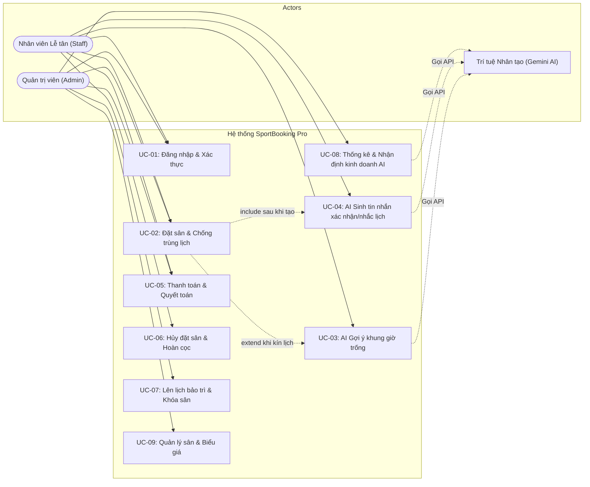

# ĐẶC TẢ CÁC CA SỬ DỤNG (USE CASE SPECIFICATIONS)

**Dự án:** Hệ thống Quản lý Sân Thể Thao Tích Hợp AI (SportBooking Pro)  
**Học phần:** AIA331 – Ứng dụng Trí tuệ Nhân tạo | **Mã lớp:** 80302  
**Thực hiện:** Nhóm 14  
**Phiên bản:** 1.0.0  
**Ngày cập nhật:** Tháng 09/2025  

---

## MỤC LỤC
1. [Tổng quan về Ca Sử Dụng](#1-tổng-quan-về-ca-sử-dụng)
2. [Sơ đồ Ca Sử Dụng Tổng thể (Use Case Diagram)](#2-sơ-đồ-ca-sử-dụng-tổng-thể-use-case-diagram)
3. [Danh mục Các Ca Sử Dụng (Use Case Index)](#3-danh-mục-các-ca-sử-dụng-use-case-index)
4. [Đặc tả Chi tiết Từng Ca Sử Dụng](#4-đặc-tả-chi-tiết-từng-ca-sử-dụng)
   - 4.1. UC-01: Đăng nhập & Xác thực Hệ thống (Login & Authentication)
   - 4.2. UC-02: Đặt Sân tại Quầy & Chống Trùng Lịch (Create Booking with Conflict Resolution)
   - 4.3. UC-03: Trợ lý AI Gợi ý Khung Giờ Trống (AI Smart Slot Suggestion)
   - 4.4. UC-04: Sinh Tin nhắn Xác nhận & Nhắc lịch bằng AI (AI Notification Generator)
   - 4.5. UC-05: Xử lý Thanh toán & Quyết toán Hóa đơn (Payment Settlement)
   - 4.6. UC-06: Hủy Đặt Sân & Hoàn Tiền Cọc (Cancel Booking & Refund)
   - 4.7. UC-07: Thiết lập Lịch Bảo Trì & Tự động Khóa Sân (Maintenance Lockout)
   - 4.8. UC-08: Thống kê Doanh thu & Nhận định Kinh doanh bằng AI (Business Analytics & AI Insights)
   - 4.9. UC-09: Quản lý Danh mục Sân & Cấu hình Đơn giá (Court & Pricing Management)
5. [Ma trận Truy vết (Traceability Matrix)](#5-ma-trận-truy-vết-traceability-matrix)

---

## 1. TỔNG QUAN VỀ CA SỬ DỤNG

Tài liệu này đặc tả chi tiết các tình huống sử dụng (Use Cases) của hệ thống **SportBooking Pro**, mô tả rõ ràng sự tương tác giữa các tác nhân người dùng (`Admin`, `Staff`, `Customer`) và hệ thống thông minh bên ngoài (`AI Engine - Google Gemini`).

### Các Tác nhân Chính (Actors):
1. **Quản trị viên (Admin):** Người nắm toàn quyền quản lý hệ thống, cấu hình sân, xem doanh thu tài chính và nhận tư vấn chiến lược từ AI.
2. **Nhân viên Lễ tân (Staff):** Người thực hiện các tác vụ hàng ngày tại quầy: kiểm tra lịch, tạo đặt sân, sử dụng AI hỗ trợ tư vấn giờ trống, tạo tin nhắn xác nhận và thanh toán.
3. **Khách hàng (Customer):** Người chơi thể thao (tác nhân gián tiếp thông qua nhân viên quầy).
4. **AI Engine (Gemini Service):** Hệ thống thông minh cung cấp khả năng gợi ý lịch trống, sinh tin nhắn và phân tích số liệu lấp đầy.

---

## 2. SƠ ĐỒ CA SỬ DỤNG TỔNG THỂ (USE CASE DIAGRAM)



---

## 3. DANH MỤC CÁC CA SỬ DỤNG (USE CASE INDEX)

| Mã Use Case | Tên Ca Sử Dụng | Tác nhân chính (Actor) | Mức độ ưu tiên | Mô tả tóm tắt |
|:---|:---|:---|:---:|:---|
| **UC-01** | Đăng nhập & Xác thực | Admin, Staff | Bắt buộc | Xác thực danh tính và phân quyền bằng JWT. |
| **UC-02** | Đặt Sân & Chống Trùng Lịch | Staff, Admin | Bắt buộc | Tạo đơn đặt sân, áp dụng khóa hàng chống xung đột. |
| **UC-03** | AI Gợi ý Khung Giờ Trống | Staff, Admin | Bắt buộc | AI quét lịch trống CSDL và đưa ra 2-3 gợi ý tối ưu. |
| **UC-04** | AI Sinh Tin Nhắn CSKH | Staff, Admin | Quan trọng | Tự động sinh tin nhắn Zalo/SMS xác nhận hoặc nhắc lịch. |
| **UC-05** | Thanh toán & Quyết toán | Staff, Admin | Bắt buộc | Thu tiền cọc hoặc thanh toán tổng tiền khi hoàn tất. |
| **UC-06** | Hủy Đặt Sân & Hoàn Cọc | Staff, Admin | Quan trọng | Hủy lịch, giải phóng slot và hoàn cọc theo chính sách. |
| **UC-07** | Lên Lịch Bảo Trì & Khóa Sân | Admin | Quan trọng | Khóa sân bảo dưỡng, chặn toàn bộ slot tương ứng. |
| **UC-08** | Thống kê Doanh thu & AI Insights | Admin | Quan trọng | Biểu đồ tài chính và AI tư vấn kích cầu giờ thấp điểm. |
| **UC-09** | Quản lý Sân & Biểu Giá | Admin | Bắt buộc | Thêm, sửa, ngưng hoạt động sân và điều chỉnh giá thuê. |

---

## 4. ĐẶC TẢ CHI TIẾT TỪNG CA SỬ DỤNG

### 4.1. UC-01: Đăng nhập & Xác thực Hệ thống (Login & Authentication)
- **Tác nhân chính:** Nhân viên Lễ tân (`Staff`), Quản trị viên (`Admin`).
- **Tiền điều kiện:** Người dùng truy cập vào trang web của hệ thống và tài khoản đã được kích hoạt trong bảng `users`.
- **Luồng sự kiện chính (Normal Flow):**
  1. Người dùng nhập `username` và `password` vào biểu mẫu đăng nhập.
  2. Người dùng nhấn nút *"Đăng nhập"*.
  3. Hệ thống gửi yêu cầu xác thực `POST /auth/login` tới Backend.
  4. Backend truy vấn người dùng theo `username`, sử dụng thư viện `passlib (Bcrypt)` để so sánh chuỗi mật khẩu nhập vào với `password_hash` trong CSDL.
  5. Khi mật khẩu khớp: Backend tạo `access_token` định dạng JWT chứa `sub: username` và `role: admin|staff`.
  6. Frontend nhận token, lưu vào `localStorage`, cập nhật ngữ cảnh phiên làm việc và điều hướng người dùng đến trang `Dashboard` (hoặc `Calendar`).
- **Luồng nhánh / Ngoại lệ (Alternative & Exception Flows):**
  - *4a. Sai tên đăng nhập hoặc sai mật khẩu:* Backend trả về HTTP 401 Unauthorized (`"Tên đăng nhập hoặc mật khẩu không chính xác"`). Frontend hiển thị thông báo lỗi phát sáng màu đỏ và giữ nguyên giao diện để người dùng nhập lại.
  - *4b. Thiếu thông tin bắt buộc:* Frontend tự động validate chặn gửi form nếu để trống ô nhập liệu.
- **Hậu điều kiện:** Người dùng có phiên làm việc hợp lệ và được cấp quyền truy cập các tính năng tương ứng với vai trò của mình.

---

### 4.2. UC-02: Đặt Sân tại Quầy & Chống Trùng Lịch (Create Booking with Conflict Resolution)
- **Tác nhân chính:** Nhân viên Lễ tân (`Staff`), Khách hàng (`Customer`).
- **Tiền điều kiện:** Nhân viên đã đăng nhập thành công vào hệ thống.
- **Luồng sự kiện chính (Normal Flow):**
  1. Khách hàng liên hệ đặt sân (trực tiếp tại quầy hoặc gọi điện).
  2. Nhân viên mở màn hình Lưới Lịch (`Calendar Grid`), chọn ngày và loại sân khách yêu cầu.
  3. Nhân viên click vào khung giờ còn hiển thị màu xanh (`available`).
  4. Hệ thống mở cửa sổ Modal đặt sân. Nhân viên nhập số điện thoại của khách:
     - Nếu khách đã có trong hệ thống, tự động điền Tên khách hàng.
     - Nếu là khách mới, nhân viên nhập thêm Tên và Ghi chú.
  5. Nhân viên nhập số tiền khách đặt cọc trước (nếu có) và nhấn nút *"Xác nhận đặt sân"*.
  6. Backend mở Database Transaction, thực thi câu lệnh truy vấn có khóa dòng:
     ```python
     slot = db.query(TimeSlot).filter_by(id=slot_id).with_for_update().first()
     ```
  7. Backend kiểm tra thấy `slot.status == "available"`, lập tức đổi trạng thái thành `"booked"`.
  8. Hệ thống tạo bản ghi `Booking` với `total_amount` tính tự động từ giá sân, lưu bản ghi `Payment` cọc (nếu tiền cọc > 0) và commit transaction.
  9. Frontend cập nhật ngay ô lịch sang màu cam/đỏ (`Đã đặt`), thông báo thành công.
- **Luồng ngoại lệ (Concurrency Conflict - Bị trùng lịch đồng thời):**
  - *7a. Khung giờ vừa bị người khác đặt trước vài mili-giây:*
    - Khi dòng slot được giải phóng từ transaction trước, hệ thống kiểm tra thấy `slot.status != "available"`.
    - Backend hủy transaction và trả về mã lỗi **HTTP 409 Conflict**: `"Khung giờ này vừa được đặt bởi người khác. Vui lòng chọn giờ khác!"`.
    - Frontend hiển thị cảnh báo đỏ và tự động kích hoạt gợi ý chuyển sang tính năng **UC-03 (AI Gợi ý khung giờ trống)**.
- **Hậu điều kiện:** Khung giờ được bảo lưu duy nhất cho khách hàng, không ai khác có thể đặt đè lên.

---

### 4.3. UC-03: Trợ lý AI Gợi ý Khung Giờ Trống (AI Smart Slot Suggestion)
- **Tác nhân chính:** Nhân viên Lễ tân (`Staff`), AI Engine (`Gemini`).
- **Tiền điều kiện:** Nhân viên đang ở màn hình Đặt sân hoặc màn hình Trợ lý AI.
- **Luồng sự kiện chính (Normal Flow):**
  1. Khung giờ khách mong muốn đã kín lịch hoặc khách chưa biết chọn giờ nào.
  2. Nhân viên chọn loại sân (ví dụ: *Sân bóng đá 7 người*), ngày muốn chơi và khung giờ ước chừng (ví dụ: *Buổi tối sau 18:00*).
  3. Nhân viên nhấn nút **"Nhờ AI Gợi ý Lịch Trống"**.
  4. Hệ thống gửi yêu cầu `POST /ai/suggest-slot` sang Backend.
  5. Backend thực hiện truy vấn CSDL tìm tất cả các `time_slots` có `status == 'available'` thuộc loại sân và ngày đó.
  6. Backend đóng gói danh sách slot trống thành cấu trúc JSON và đưa vào Prompt ngữ cảnh gửi đến Google Gemini.
  7. Gemini phân tích các tiêu chí (khoảng cách giờ, độ phù hợp, giá cả) và trả về văn bản đề xuất 2-3 khung giờ lý tưởng nhất kèm lời giải thích ngắn gọn, thân thiện.
  8. Backend lưu lượt gọi này vào bảng `ai_logs` và trả dữ liệu về Frontend.
  9. Frontend hiển thị đoạn tư vấn của AI, đồng thời tự động hiển thị các nút bấm tương ứng với các slot trống được gợi ý để nhân viên bấm chọn ngay.
- **Luồng nhánh (Hết hoàn toàn sân trống):**
  - *5a. Ngày đó không còn bất kỳ sân nào trống:*
    - Backend phát hiện `results == []`.
    - Backend **không gọi API Gemini** (tiết kiệm token) và trả về ngay thông báo: `"Hiện không còn khung giờ trống phù hợp trong ngày này"`.
- **Hậu điều kiện:** Nhân viên có phương án thay thế ngay tức thì để tư vấn cho khách mà không tốn công tra cứu thủ công.

---

### 4.4. UC-04: Sinh Tin nhắn Xác nhận & Nhắc lịch bằng AI (AI Notification Generator)
- **Tác nhân chính:** Nhân viên Lễ tân (`Staff`), AI Engine (`Gemini`).
- **Tiền điều kiện:** Phiếu đặt sân (`Booking`) đã tồn tại trên hệ thống.
- **Luồng sự kiện chính (Normal Flow):**
  1. Tại chi tiết đơn đặt sân, nhân viên nhấn nút **"Sinh tin nhắn CSKH"**.
  2. Nhân viên chọn một trong hai loại tin:
     - **Xác nhận đặt sân (Confirmation):** Gửi ngay sau khi khách cọc tiền.
     - **Nhắc lịch sắp chơi (Reminder):** Gửi trước giờ chơi vài tiếng.
  3. Hệ thống gửi request `POST /ai/generate-message/{booking_id}?message_type=...`.
  4. Backend lấy dữ liệu thật từ các bảng `customers`, `courts`, `time_slots`, `bookings`, `payments`:
     - Tên khách, Tên sân, Ngày, Giờ bắt đầu, Giờ kết thúc, Tiền cọc, Tiền còn nợ.
  5. Backend đưa các dữ liệu trên vào System Prompt đã được tối ưu chống bịa đặt (Anti-hallucination) và gọi Gemini.
  6. Gemini sinh ra đoạn tin nhắn văn phong chuẩn mực, đầy đủ biểu tượng cảm xúc thể thao, dễ đọc trên di động.
  7. Backend ghi nhận bản ghi vào `ai_logs`.
  8. Frontend hiển thị nội dung tin nhắn kèm nút **"Sao chép nội dung (Copy)"**. Nhân viên bấm nút và dán gửi trực tiếp cho khách qua Zalo/SMS.
- **Luồng ngoại lệ:**
  - *4a. Đơn đặt sân đã bị hủy (`cancelled`):* Backend từ chối sinh tin nhắn xác nhận, báo lỗi HTTP 400.
- **Hậu điều kiện:** Khách hàng nhận được tin nhắn xác thực chính xác 100% về giờ giấc và số tiền.

---

### 4.5. UC-05: Xử lý Thanh toán & Quyết toán Hóa đơn (Payment Settlement)
- **Tác nhân chính:** Nhân viên Lễ tân (`Staff`).
- **Tiền điều kiện:** Khách hàng đã hoàn thành buổi chơi thể thao và ra quầy làm thủ tục trả sân.
- **Luồng sự kiện chính (Normal Flow):**
  1. Nhân viên tìm kiếm đơn đặt của khách trên giao diện danh sách Đơn Đặt Sân.
  2. Hệ thống hiển thị chi tiết: Tổng tiền sân (`total_amount`), Số tiền đã đặt cọc trước đó (`paid_amount`), và Số tiền còn lại phải thanh toán (`remaining_balance`).
  3. Nhân viên chọn hình thức thanh toán của khách: Tiền mặt (`cash`), Quét mã chuyển khoản ngân hàng (`transfer`), hoặc Ví điện tử (`momo`).
  4. Nhân viên nhấn **"Xác nhận thanh toán"**.
  5. Backend tạo bản ghi mới trong bảng `payments` với số tiền thanh toán và trạng thái `'paid'`.
  6. Backend kiểm tra tổng số tiền đã trả: Nếu $\sum \text{payments.amount} \ge \text{total\_amount}$, hệ thống tự động đổi trạng thái đơn đặt sang `'completed'`.
  7. Hệ thống in/xuất hóa đơn xác nhận hoàn tất.
- **Hậu điều kiện:** Đơn đặt sân kết thúc với trạng thái `completed`, dòng tiền được ghi nhận vào doanh thu ngày.

---

### 4.6. UC-06: Hủy Đặt Sân & Hoàn Tiền Cọc (Cancel Booking & Refund)
- **Tác nhân chính:** Khách hàng (`Customer`), Nhân viên Lễ tân (`Staff`).
- **Tiền điều kiện:** Đơn đặt sân đang ở trạng thái `pending` hoặc `confirmed`.
- **Luồng sự kiện chính (Normal Flow):**
  1. Khách hàng thông báo hủy lịch do điều kiện thời tiết xấu hoặc lý do cá nhân.
  2. Nhân viên mở chi tiết đơn đặt, chọn tính năng **"Hủy đặt sân"**.
  3. Nhân viên nhập lý do hủy vào ô ghi chú.
  4. Hệ thống mở Transaction:
     - Chuyển trạng thái `Booking.status = 'cancelled'`.
     - Chuyển trạng thái khung giờ `TimeSlot.status = 'available'` (giải phóng để người khác có thể đặt lại ngay lập tức).
     - Nếu có chính sách hoàn tiền cọc, hệ thống tạo bản ghi thanh toán âm hoặc bản ghi refund tương ứng.
  5. Commit transaction và thông báo hoàn tất trên giao diện.
- **Hậu điều kiện:** Khung giờ sân được trả về trạng thái trống, đơn booking chuyển sang `cancelled`.

---

### 4.7. UC-07: Thiết lập Lịch Bảo Trì & Tự động Khóa Sân (Maintenance Lockout)
- **Tác nhân chính:** Quản trị viên (`Admin`).
- **Tiền điều kiện:** Admin đã đăng nhập với vai trò `admin`.
- **Luồng sự kiện chính (Normal Flow):**
  1. Admin truy cập phân hệ **"Quản lý Bảo trì Sân"**.
  2. Admin chọn sân cần bảo dưỡng (ví dụ: Sân bóng đá mini 1 cần thay đèn LED và chải lại cỏ).
  3. Admin chọn ngày bắt đầu (`start_date`), ngày kết thúc (`end_date`) và nhập lý do bảo trì.
  4. Hệ thống kiểm tra trong khoảng ngày này:
     - Nếu có đơn đặt sân nào của khách đã tồn tại, hiển thị cảnh báo danh sách các khách hàng bị ảnh hưởng để admin/lễ tân liên hệ dời sân cho khách trước.
  5. Admin xác nhận tạo lịch bảo trì.
  6. Hệ thống lưu bản ghi vào `maintenance_schedules`.
  7. Khi trạng thái bảo trì chuyển sang `in_progress`, hệ thống tự động cập nhật `Court.status = 'maintenance'` và tự động chuyển toàn bộ các `time_slots` của sân này trong khoảng thời gian đó thành `'blocked'`.
  8. Toàn bộ nhân viên tại quầy không thể click đặt sân vào các khung giờ bị khóa này.
- **Hậu điều kiện:** Sân được bảo vệ kỹ thuật an toàn, không phát sinh xung đột khách hàng.

---

### 4.8. UC-08: Thống kê Doanh thu & Nhận định Kinh doanh bằng AI (Business Analytics & AI Insights)
- **Tác nhân chính:** Quản trị viên (`Admin`), AI Engine (`Gemini`).
- **Tiền điều kiện:** Admin đã đăng nhập hệ thống và cơ sở đã có dữ liệu vận hành.
- **Luồng sự kiện chính (Normal Flow):**
  1. Admin chọn tab **"Báo cáo & Thống kê"**.
  2. Admin chọn khoảng thời gian cần phân tích (ví dụ: Từ ngày 01 đến ngày 30 của tháng).
  3. Hệ thống hiển thị biểu đồ trực quan: Tổng doanh thu, Doanh thu theo từng sân, Biểu đồ công suất lấp đầy theo khung giờ trong ngày.
  4. Admin nhấn nút **"Nhận Định Chiến Lược Từ Trợ Lý AI"**.
  5. Backend thực hiện truy vấn tổng hợp số liệu tỷ lệ lấp đầy (%) theo từng khung giờ trong ngày (xử lý logic trong Python để đảm bảo an toàn đa CSDL).
  6. Backend gửi số liệu tổng hợp sạch (không kèm thông tin cá nhân khách hàng) sang mô hình Gemini với vai trò Cố vấn Kinh doanh Thể thao.
  7. Gemini phân tích:
     - Chỉ ra khung giờ vàng có nhu cầu cao (Peak hours).
     - Chỉ ra khung giờ vắng khách (Off-peak hours).
     - Đề xuất 2 chiến dịch marketing/khuyến mại cụ thể (Ví dụ: Giảm giá 30% ca sáng cho học sinh/sinh viên, bán gói hội viên tháng).
  8. Hệ thống lưu log vào `ai_logs` và hiển thị bản phân tích chuyên sâu cho Admin.
- **Hậu điều kiện:** Chủ sân có cái nhìn toàn diện và có hành động cụ thể để gia tăng doanh số.

---

### 4.9. UC-09: Quản lý Danh mục Sân & Cấu hình Đơn giá (Court & Pricing Management)
- **Tác nhân chính:** Quản trị viên (`Admin`).
- **Tiền điều kiện:** Admin đăng nhập tài khoản có quyền `role == 'admin'`.
- **Luồng sự kiện chính (Normal Flow):**
  1. Admin truy cập màn hình **"Danh mục Sân Thể Thao"**.
  2. Admin có thể thực hiện:
     - **Thêm sân mới:** Nhập tên sân, chọn loại sân, điền đơn giá theo giờ (`price_per_hour`), tải lên ảnh chụp sân.
     - **Sửa thông tin:** Thay đổi tên sân, điều chỉnh biểu phí giờ thuê. Biểu phí mới sẽ áp dụng cho các lượt đặt sân trong tương lai, không ảnh hưởng hóa đơn cũ.
     - **Ngưng hoạt động (Xóa mềm):** Chuyển trạng thái sân thành `inactive`. Sân sẽ bị ẩn khỏi lưới đặt lịch mới nhưng toàn bộ báo cáo doanh thu lịch sử vẫn được bảo toàn trọn vẹn.
- **Hậu điều kiện:** Danh mục sân và bảng giá được cập nhật tức thì trên toàn hệ thống.

---

## 5. MA TRẬN TRUY VẾT (TRACEABILITY MATRIX)

Bảng đối chiếu đảm bảo mọi yêu cầu chức năng (FR) trong tài liệu `requirements.md` đều được hiện thực hóa qua các ca sử dụng (UC) tương ứng:

| Mã Yêu cầu Chức năng (FR) | Tên Phân hệ Nghiệp vụ | Ca Sử Dụng Hiện Thực (Use Case) | Ghi chú & Trạng thái |
|:---|:---|:---:|:---|
| **FR-01** | Xác thực & Phân quyền RBAC | **UC-01** | Đã triển khai hoàn tất (JWT, Bcrypt) |
| **FR-02** | Quản lý Sân & Khung giờ | **UC-02, UC-09** | Đã triển khai hoàn tất |
| **FR-03** | Đặt sân & Khóa chống trùng lịch | **UC-02, UC-06** | Trọng tâm đồ án, test concurrency pass 100% |
| **FR-04** | Quản lý Hồ sơ Khách hàng | **UC-02, UC-04** | Tự động hóa tạo mới & tra cứu nhanh theo SĐT |
| **FR-05** | Thanh toán & Công nợ Hóa đơn | **UC-02, UC-05, UC-06**| Hỗ trợ tiền cọc, chuyển khoản, tiền mặt |
| **FR-06** | Quản lý Lịch Bảo trì Sân | **UC-07** | Tự động khóa slot và đổi trạng thái sân |
| **FR-07** | Báo cáo Thống kê Doanh thu | **UC-08** | Biểu đồ trực quan & dữ liệu tổng hợp |
| **FR-08.1** | AI Gợi ý Khung giờ trống | **UC-03** | Lọc DB thật, chống hallucination |
| **FR-08.2** | AI Sinh tin nhắn Xác nhận / Nhắc lịch | **UC-04** | Cá nhân hóa theo dữ liệu booking thật |
| **FR-08.3** | AI Phân tích công suất & Đề xuất giá | **UC-08** | Tối ưu hóa giờ thấp điểm |
| **FR-08.4** | Ghi log minh chứng AI | **Tất cả UC có AI** | Lưu đầy đủ vào bảng `ai_logs` |

---
**Kết luận:** Bản đặc tả ca sử dụng `use_cases.md` mô tả toàn diện, chi tiết và nhất quán luồng nghiệp vụ của hệ thống SportBooking Pro, là cơ sở vững chắc để phát triển, kiểm thử và nghiệm thu đồ án.
